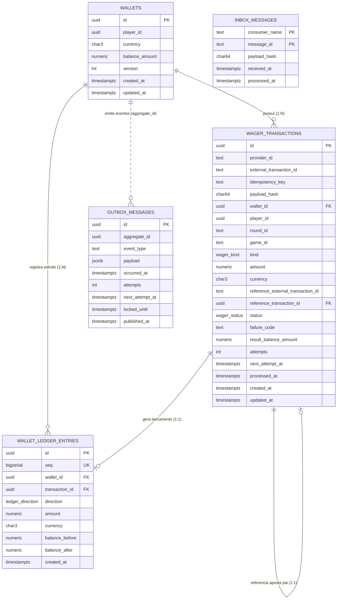

# 🏛️ Arquitetura do Banco de Dados & Dicionário de Dados

Este documento descreve detalhadamente a modelagem relacional, arquitetura de persistência, diagrama de entidades e relacionamentos, invariantes financeiras e dicionário completo de campos do **Distributed Wagering Processor** no **PostgreSQL**.

---

## 1. Visão Geral da Arquitetura de Dados

O banco de dados foi projetado seguindo os princípios de **Contabilidade de Partidas Dobradas (Double-Entry Bookkeeping)** e **Defesa em Profundidade (Defense in Depth)**. As regras críticas de integridade financeira residem não apenas na camada de aplicação, mas são impostas de forma intransigente pelo próprio PostgreSQL através de:
* **Tipagem Monetária Estrita:** `NUMERIC(20,2)` em todos os saldos e valores para eliminação absoluta de imprecisões de ponto flutuante (*floating-point errors*).
* **Ledger Imutável (*Append-Only*):** O histórico contábil é gravado exclusivamente via `INSERT`. Triggers de banco bloqueiam qualquer tentativa de `UPDATE` ou `DELETE`.
* **Estados Terminais Imutáveis:** Transações que atingiram desfecho final (`PROCESSED`, `REJECTED`, `FAILED`) são blindadas contra mutação via trigger.
* **Idempotência Persistente:** Índices únicos em `idempotency_key` e `(provider_id, external_transaction_id)`.
* **Proteção contra Dupla Reversão:** Índice único parcial impedindo mais de um estorno (`REFUND`) ou cancelamento (`ROLLBACK`) para a mesma aposta.
* **Garantia de Entrega At-Least-Once:** Tabelas transacionais para mensageria assíncrona (**Transactional Outbox Pattern** e **Inbox Pattern**).

---

## 2. Diagrama Entidade-Relacionamento (ERD)



---

## 3. Tipos Customizados (ENUMs)

O schema utiliza três enums nativos do PostgreSQL para garantir valores válidos em tempo de compilação/execução:

### 3.1. `wager_kind`
Define a natureza da operação financeira solicitada:
* `OPENING`: Saldo inicial concedido na abertura da carteira.
* `BET`: Aposta com débito imediato de saldo.
* `WIN`: Prêmio/ganho creditado ao saldo (pode referenciar uma `BET`).
* `LOSS`: Registro de aposta perdida sem movimentação de saldo.
* `REFUND`: Estorno administrativo ou de aposta cancelada pelo provedor (devolve o débito).
* `ROLLBACK`: Cancelamento de operação anterior (ex: cancelamento de um prêmio `WIN`).
* `DEPOSIT`: Depósito financeiro via gateway/PIX com crédito em conta.

### 3.2. `wager_status`
Define o ciclo de vida e estado de liquidação da transação:
* `PENDING`: Transação criada, aguardando início do processamento.
* `PENDING_REFERENCE`: Transação dependente (`WIN`, `REFUND`, `ROLLBACK`) recebida **fora de ordem** antes da aposta de referência (`BET`). Fica sob custódia aguardando o **Pending Reference Resolver**.
* `PROCESSED`: Estado terminal de sucesso contábil. Saldo movimentado, lançamento gerado no ledger e evento publicado no outbox.
* `REJECTED`: Estado terminal de rejeição por regra de negócio (ex: `INSUFFICIENT_FUNDS`, `ALREADY_REVERSED`, `INVALID_AMOUNT`).
* `FAILED`: Estado terminal por falha não recuperável ou exaustão de retentativas.

### 3.3. `ledger_direction`
Sentido da movimentação contábil no livro-razão:
* `CREDIT`: Entrada de fundos (aumenta o saldo: `balance_after = balance_before + amount`).
* `DEBIT`: Saída de fundos (reduz o saldo: `balance_after = balance_before - amount`).

---

## 4. Catálogo Detalhado das Tabelas

---

### 4.1. Tabela: `wallets`
Responsável pela manutenção do saldo consolidado do jogador e controle de concorrência.

#### Campos
| Coluna | Tipo | Nulo? | Padrão | Descrição |
|---|---|---|---|---|
| `id` | `UUID` | **NÃO** | — | Chave primária identificadora da carteira. |
| `player_id` | `UUID` | **NÃO** | — | Identificador do jogador proprietário. |
| `currency` | `CHAR(3)` | **NÃO** | — | Código ISO 4217 da moeda (ex: `BRL`, `USD`). |
| `balance_amount` | `NUMERIC(20,2)` | **NÃO** | — | Saldo contábil disponível em conta. |
| `version` | `INTEGER` | **NÃO** | — | Versão incremental para controle de concorrência. |
| `created_at` | `TIMESTAMPTZ` | **NÃO** | `now()` | Data/hora de abertura da carteira. |
| `updated_at` | `TIMESTAMPTZ` | **NÃO** | `now()` | Data/hora da última movimentação de saldo. |

#### Constraints & Índices
* **PK:** `PRIMARY KEY (id)`
* **UK:** `ux_wallets_player_currency UNIQUE (player_id, currency)` — Um jogador só pode possuir uma carteira por moeda.
* **CHECK:** `ck_wallets_balance_non_negative (balance_amount >= 0)` — **Invariante financeira:** Saldo jamais pode ficar negativo.
* **CHECK:** `ck_wallets_version_positive (version >= 1)` — Versão deve iniciar em 1 ou superior.
* **CHECK:** `ck_wallets_currency_format (currency ~ '^[A-Z]{3}$')` — Código da moeda deve ter exatamente 3 letras maiúsculas.

---

### 4.2. Tabela: `wager_transactions`
Coração transacional do sistema. Registra cada operação solicitada por provedores de jogos ou gateways financeiros, gerenciando idempotência, desfechos e resoluções fora de ordem.

#### Campos
| Coluna | Tipo | Nulo? | Padrão | Descrição |
|---|---|---|---|---|
| `id` | `UUID` | **NÃO** | — | Chave primária única da transação. |
| `provider_id` | `TEXT` | **NÃO** | — | Identificador do provedor externo (ex: `provider-pragmatic`, `evolution`, `PIX_GATEWAY`). |
| `external_transaction_id` | `TEXT` | **NÃO** | — | Identificador da transação no sistema do provedor. |
| `idempotency_key` | `TEXT` | **NÃO** | — | Chave de idempotência do cabeçalho HTTP ou payload SQS. |
| `payload_hash` | `CHAR(64)` | **NÃO** | — | Hash SHA-256 canônico do payload original para validação de conflito de idempotência. |
| `wallet_id` | `UUID` | **NÃO** | — | Chave estrangeira referenciando `wallets(id)`. |
| `player_id` | `UUID` | **NÃO** | — | Identificador do jogador associado. |
| `round_id` | `TEXT` | **NÃO** | — | Identificador da rodada do jogo. |
| `game_id` | `TEXT` | **NÃO** | — | Identificador do jogo/mesa de aposta. |
| `kind` | `wager_kind` | **NÃO** | — | Tipo de operação contábil (`BET`, `WIN`, `REFUND`, `ROLLBACK`, `DEPOSIT`, etc.). |
| `amount` | `NUMERIC(20,2)` | **NÃO** | — | Valor monetário nominal da transação. |
| `currency` | `CHAR(3)` | **NÃO** | — | Moeda da transação (deve bater com a carteira). |
| `reference_external_transaction_id` | `TEXT` | SIM | `NULL` | ID externo da transação de referência para operações dependentes (`REFUND`, `ROLLBACK`, `WIN`). |
| `reference_transaction_id` | `UUID` | SIM | `NULL` | Chave estrangeira resolvida apontando para `wager_transactions(id)`. |
| `status` | `wager_status` | **NÃO** | — | Estado atual (`PENDING`, `PENDING_REFERENCE`, `PROCESSED`, `REJECTED`, `FAILED`). |
| `failure_code` | `TEXT` | SIM | `NULL` | Código da falha caso rejeitada (ex: `INSUFFICIENT_FUNDS`, `REFERENCE_NOT_FOUND`). |
| `result_balance_amount` | `NUMERIC(20,2)` | SIM | `NULL` | Snapshot imutável do saldo da carteira imediatamente após o processamento. |
| `attempts` | `INTEGER` | **NÃO** | `0` | Número de tentativas executadas pelo resolver para transações fora de ordem. |
| `next_attempt_at` | `TIMESTAMPTZ` | SIM | `NULL` | Data/hora da próxima tentativa agendada com backoff exponencial e jitter. |
| `processed_at` | `TIMESTAMPTZ` | SIM | `NULL` | Timestamp da liquidação terminal. |
| `created_at` | `TIMESTAMPTZ` | **NÃO** | `now()` | Data/hora de inserção do registro. |
| `updated_at` | `TIMESTAMPTZ` | **NÃO** | `now()` | Data/hora da última alteração de estado. |

#### Constraints & Índices
* **PK:** `PRIMARY KEY (id)`
* **FK:** `FOREIGN KEY (wallet_id) REFERENCES wallets (id)`
* **FK:** `FOREIGN KEY (reference_transaction_id) REFERENCES wager_transactions (id)`
* **UK:** `ux_wager_idempotency_key UNIQUE (idempotency_key)` — Garante que nenhuma chave de requisição seja executada duas vezes.
* **UK:** `ux_wager_provider_external UNIQUE (provider_id, external_transaction_id)` — Impede duplicação da mesma transação externa por provedor.
* **Índice Único Parcial:** `ux_single_reversal UNIQUE (reference_transaction_id) WHERE kind IN ('REFUND', 'ROLLBACK') AND status = 'PROCESSED'` — **Garantia Anti-Fraude:** Uma aposta só pode ser revertida uma única vez no sistema.
* **CHECK:** `ck_wager_amount_positive (amount > 0)` — Valores transacionados devem ser estritamente positivos.
* **CHECK:** `ck_wager_result_balance_non_negative (result_balance_amount IS NULL OR result_balance_amount >= 0)`
* **CHECK:** `ck_wager_reversal_requires_reference` — Operações de `REFUND` ou `ROLLBACK` exigem obrigatoriamente preenchimento de `reference_external_transaction_id`.
* **CHECK:** `ck_wager_processed_reversal_resolved` — Reversões com status `PROCESSED` exigem `reference_transaction_id` interno resolvido.
* **CHECK:** `ck_wager_failure_code` — Transações `REJECTED` ou `FAILED` exigem preenchimento de `failure_code`.
* **CHECK:** `ck_wager_processed_at` — Transações `PROCESSED` exigem `processed_at` preenchido.
* **CHECK:** `ck_wager_pending_ref_scheduled` — Transações `PENDING_REFERENCE` exigem `next_attempt_at` preenchido.
* **Índice Parcial:** `ix_pending_ref (next_attempt_at) WHERE status = 'PENDING_REFERENCE'` — Otimizado para o worker de resolução com `SKIP LOCKED`.
* **Índice Parcial:** `ix_ref_lookup (provider_id, reference_external_transaction_id) WHERE reference_external_transaction_id IS NOT NULL` — Otimizado para o Fast-Path de resolução de pendências.
* **Índice:** `ix_wager_wallet (wallet_id, created_at)` — Otimizado para histórico da carteira.

#### Triggers de Banco
* **`trg_wager_tx_terminal_state`:** Disparada `BEFORE UPDATE`. Executa a função `fn_wager_tx_terminal_state()`. Se `OLD.status` for `PROCESSED`, `REJECTED` ou `FAILED`, **bloqueia sumariamente a alteração** com exceção de violação de integridade.

---

### 4.3. Tabela: `wallet_ledger_entries`
O livro-razão contábil formal. Registra cada centavo creditado ou debitado, compondo uma trilha de auditoria append-only imutável.

#### Campos
| Coluna | Tipo | Nulo? | Padrão | Descrição |
|---|---|---|---|---|
| `id` | `UUID` | **NÃO** | — | Identificador único do lançamento. |
| `seq` | `BIGSERIAL` | **NÃO** | *auto* | Sequenciador monotônico global único para paginação contábil determinística. |
| `wallet_id` | `UUID` | **NÃO** | — | Chave estrangeira referenciando `wallets(id)`. |
| `transaction_id` | `UUID` | **NÃO** | — | Chave estrangeira referenciando `wager_transactions(id)`. |
| `direction` | `ledger_direction` | **NÃO** | — | Sentido do fluxo: `CREDIT` ou `DEBIT`. |
| `amount` | `NUMERIC(20,2)` | **NÃO** | — | Valor monetário movimentado no lançamento. |
| `currency` | `CHAR(3)` | **NÃO** | — | Moeda da movimentação. |
| `balance_before` | `NUMERIC(20,2)` | **NÃO** | — | Saldo imediatamente anterior à operação. |
| `balance_after` | `NUMERIC(20,2)` | **NÃO** | — | Saldo resultante imediatamente posterior. |
| `created_at` | `TIMESTAMPTZ` | **NÃO** | `now()` | Timestamp exato em que a linha foi inserida. |

#### Constraints & Índices
* **PK:** `PRIMARY KEY (id)`
* **FK:** `FOREIGN KEY (wallet_id) REFERENCES wallets (id)`
* **FK:** `FOREIGN KEY (transaction_id) REFERENCES wager_transactions (id)`
* **UK:** `ux_ledger_seq UNIQUE (seq)` — Ordenação contábil estrita sem ambiguidades de timestamp.
* **UK:** `ux_ledger_tx_wallet UNIQUE (transaction_id, wallet_id)` — Uma transação só pode gerar exatamente um lançamento contábil na mesma carteira.
* **CHECK:** `ck_ledger_amount_positive (amount > 0)`
* **CHECK:** `ck_ledger_balance_before_non_negative (balance_before >= 0)`
* **CHECK:** `ck_ledger_balance_after_non_negative (balance_after >= 0)`
* **CHECK Aritmético Rigoroso:** `ck_ledger_arithmetic`:
  ```sql
  CHECK (
    (direction = 'CREDIT' AND balance_after = balance_before + amount) OR
    (direction = 'DEBIT'  AND balance_after = balance_before - amount)
  )
  ```
* **Índice Composto:** `ix_ledger_wallet_seq (wallet_id, seq)` — Permite paginação ultrarrápida do extrato via cursor binário.

#### Triggers de Banco
* **`trg_ledger_entries_immutable`:** Disparada `BEFORE UPDATE OR DELETE`. Executa a função `fn_ledger_immutable()`. **Proíbe sumariamente qualquer edição ou deleção**, transformando a tabela em append-only estrito.

---

### 4.4. Tabela: `outbox_messages`
Implementação do **Transactional Outbox Pattern**. Garante que todo evento contábil gerado dentro da transação do banco seja garantidamente entregue ao SQS FIFO sem depender de transações distribuídas (2PC).

#### Campos
| Coluna | Tipo | Nulo? | Padrão | Descrição |
|---|---|---|---|---|
| `id` | `UUID` | **NÃO** | — | Chave primária única da mensagem (usada como Deduplication ID no SQS). |
| `aggregate_id` | `UUID` | **NÃO** | — | ID do agregado raiz (normalmente o `wallet_id`). Usado como Message Group ID no SQS FIFO para garantir ordem por carteira. |
| `event_type` | `TEXT` | **NÃO** | — | Nome do evento (ex: `WalletBalanceChanged`, `WagerTransactionProcessed`). |
| `payload` | `JSONB` | **NÃO** | — | Dados completos do evento serializados em formato JSON binário. |
| `occurred_at` | `TIMESTAMPTZ` | **NÃO** | — | Data/hora em que a transação contábil foi confirmada. |
| `attempts` | `INTEGER` | **NÃO** | `0` | Quantidade de tentativas de envio ao broker SQS. |
| `next_attempt_at` | `TIMESTAMPTZ` | **NÃO** | — | Momento a partir do qual a mensagem está elegível para envio. |
| `locked_until` | `TIMESTAMPTZ` | SIM | `NULL` | Timestamp de lease para evitar que múltiplos publishers processem a mesma mensagem. |
| `published_at` | `TIMESTAMPTZ` | SIM | `NULL` | Data/hora em que o SQS retornou confirmação de publicação com sucesso. |

#### Constraints & Índices
* **PK:** `PRIMARY KEY (id)`
* **CHECK:** `ck_outbox_attempts_non_negative (attempts >= 0)`
* **Índice Parcial:** `ix_outbox_pending (next_attempt_at) WHERE published_at IS NULL` — Garante varredura instantânea de mensagens pendentes pelo worker de Outbox com `FOR UPDATE SKIP LOCKED`.

---

### 4.5. Tabela: `inbox_messages`
Implementação do **Transactional Inbox Pattern**. Desduplica mensagens recebidas pelo consumidor do SQS FIFO antes de invocar os casos de uso contábeis.

#### Campos
| Coluna | Tipo | Nulo? | Padrão | Descrição |
|---|---|---|---|---|
| `consumer_name` | `TEXT` | **NÃO** | — | Identificador do consumidor/fila (ex: `wager-transactions-consumer`). |
| `message_id` | `TEXT` | **NÃO** | — | Identificador da mensagem no SQS ou ID da transação. |
| `payload_hash` | `CHAR(64)` | **NÃO** | — | Hash SHA-256 do corpo da mensagem para validação de integridade. |
| `received_at` | `TIMESTAMPTZ` | **NÃO** | `now()` | Momento do recebimento da mensagem no worker. |
| `processed_at` | `TIMESTAMPTZ` | SIM | `NULL` | Momento em que a mensagem concluiu o processamento de negócio. |

#### Constraints & Índices
* **PK Composta:** `PRIMARY KEY (consumer_name, message_id)` — A chave primária composta garante atomicamente via `INSERT ... ON CONFLICT DO NOTHING` que uma mesma mensagem nunca será reprocessada.

---

## 5. Resumo das Relações e Integridade Referencial

```
+-----------------------------------------------------------------------------------+
| Relação                                | Tipo | Regra de Deleção / Ação           |
+----------------------------------------+------+-----------------------------------+
| wallets -> wager_transactions          | 1:N  | RESTRICT (não deleta wallet com tx|
| wallets -> wallet_ledger_entries       | 1:N  | RESTRICT (não deleta wallet com tx|
| wager_transactions -> ledger_entries   | 1:1  | RESTRICT (imutabilidade mútua)    |
| wager_transactions -> wager_transact.  | 1:1  | Auto-relacionamento (reversão)    |
| wallets ..> outbox_messages            | 1:N  | Fraco (aggregate_id desacoplado)  |
+-----------------------------------------------------------------------------------+
```

---

## 6. Mecanismos de Concorrência & Locks

1. **Locks Pessimistas de Carteira (`SELECT ... FOR UPDATE`):**
   * Toda transação de escrita financeira realiza lock exclusivo na linha correspondente da tabela `wallets`.
   * Impede condições de corrida (*race conditions*) em apostas simultâneas na mesma carteira (hot wallet).
2. **Workers Desacoplados com `SKIP LOCKED`:**
   * Tanto o **Outbox Publisher** quanto o **Pending Reference Resolver** utilizam:
     ```sql
     SELECT * FROM outbox_messages
     WHERE published_at IS NULL AND next_attempt_at <= now()
     LIMIT 50
     FOR UPDATE SKIP LOCKED;
     ```
   * Isso garante escalabilidade horizontal perfeita: 10 instâncias podem rodar em paralelo sem que nenhuma trave ou dispute o mesmo registro que outra.
