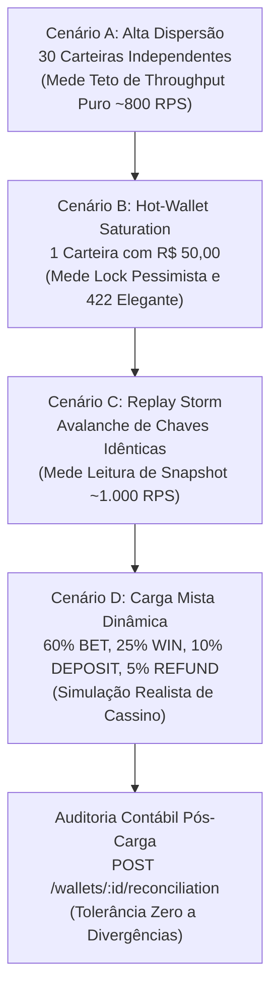

# 🧪 Guia Completo de Testes & Benchmarks (Testing Guide)

> Manual operacional definitivo para execução, depuração e validação de todas as camadas de testes do **Distributed Wagering Processor**: desde as guardas estáticas financeiras (`lint:money`), pirâmide de testes unitários e de integração até os testes de alta concorrência, multi-instância e a suíte de benchmarks de carga da Fase 10 (`test:load`).

---

## 🧭 Sumário Rápido

1. [Pré-requisitos e Infraestrutura](#-1-pré-requisitos-e-infraestrutura)
2. [A Pirâmide Fail-Fast (`bun run test:all`)](#-2-a-pirâmide-fail-fast-bun-run-testall)
3. [Testes Segmentados Passo a Passo](#-3-testes-segmentados-passo-a-passo)
4. [Testes de Carga & Benchmarking de Performance (Fase 10)](#-4-testes-de-carga--benchmarking-de-performance-fase-10)
5. [Telemetria e Auditoria em Tempo Real](#-5-telemetria-e-auditoria-em-tempo-real)
6. [Tabela de Referência Rápida dos Comandos](#-6-tabela-de-referência-rápida-dos-comandos)

---

## 🛠️ 1. Pré-requisitos e Infraestrutura

A maioria dos testes de integração, concorrência, multi-instância e carga depende dos serviços reais rodando via Docker:
- **PostgreSQL 16**: Armazena as carteiras, ledger imutável, transações, outbox e locks pessimistas.
- **LocalStack (AWS SQS FIFO)**: Simula as filas de mensageria `wallet-events.fifo`, `wager-transactions.fifo` e a DLQ `wager-transactions-dlq.fifo`.

### Como Verificar e Subir a Infraestrutura:

```bash
# 1. Checar se Postgres e LocalStack estão rodando e saudáveis:
docker compose ps postgres localstack

# 2. Caso não estejam ativos, suba-os em segundo plano:
docker compose up -d postgres localstack
```

> [!TIP]
> Os testes automatizados utilizam o banco de teste compartilhado e limpam seus próprios dados via `resetData(db)`. Não é necessário recriar o container entre as execuções.

---

## 🏗️ 2. A Pirâmide Fail-Fast (`bun run test:all`)

A validação do projeto é estruturada segundo o princípio **Fail-Fast**: as etapas mais rápidas e rigorosas rodam primeiro. Se uma etapa falhar, o pipeline aborta imediatamente para economizar tempo de feedback.

```text
                  ▲
                 / \     [Etapa 6] Multi-Instância e Recuperação Distribuída (7 testes)
                /   \    [Etapa 5] Alta Concorrência & Hot-Wallets (9 testes)
               /     \   [Etapa 4] Integração Postgres & SQS FIFO (50 testes)
              /       \  [Etapa 3] Testes Unitários de Domínio & Workers (76 testes)
             /_________\ [Etapa 2] Typecheck Estrito TypeScript (tsc --noEmit)
            /___________\ [Etapa 1] Guarda Financeira (lint:money - sem floats)
```

### 🚀 Comando Único Recomendado:
Para rodar toda a esteira piramidal de uma única vez (142 testes automatizados):

```bash
bun run test:all
```
*(Aliases disponíveis: `bun run test:pipeline` ou `bun run check`)*

---

## 🧪 3. Testes Segmentados Passo a Passo

Caso queira isolar uma camada específica durante o desenvolvimento:

### 1. Guarda Financeira (`lint:money`)
- **Objetivo:** Garante que nenhum tipo nativo `number`, `float` ou função `parseFloat` seja utilizado para campos financeiros no código-fonte, forçando o uso do Value Object `Money` ou strings com 2 casas decimais fixas.
- **Comando:**
  ```bash
  bun run lint:money
  ```

### 2. Validação Estática de Tipos (`typecheck`)
- **Objetivo:** Valida tipagem estrita do TypeScript (`strict: true`, `noUncheckedIndexedAccess`).
- **Comando:**
  ```bash
  bun run typecheck
  ```

### 3. Testes Unitários de Domínio & Workers (`test:unit`)
- **Objetivo:** Executa **76 testes** ultrarrápidos em memória (< 500ms):
  - Aritmética e imutabilidade do `Money` (rejeita NaN, Infinity, notação científica e negativos).
  - Regras de negócio da `WageringPolicy` para `DEPOSIT`, `BET`, `WIN`, `LOSS`, `REFUND` e `ROLLBACK`.
  - Máquina de estados das transações financeiras (`WagerTransaction`).
  - Hashing canônico determinístico do payload de idempotência (`payloadHash`).
  - Workers e use cases isolados (`PublishOutboxMessagesUseCase`, `ResolvePendingReferencesUseCase`, `WagerTransactionsConsumerWorker`).
- **Comando:**
  ```bash
  bun run test
  # ou diretamente:
  bun test test/unit
  ```

### 4. Testes de Integração com Postgres e SQS Reais (`test:integration`)
- **Objetivo:** Executa **50 testes** contra banco PostgreSQL e LocalStack reais:
  - Locks pessimistas (`SELECT ... FOR UPDATE`), constraints de saldo `>= 0` e triggers de imutabilidade do ledger (bloqueio de UPDATE/DELETE).
  - Endpoints HTTP REST (incluindo `POST /wallets/:id/deposit` com suporte a idempotência).
  - Outbox Publisher com lock `FOR UPDATE SKIP LOCKED` e publicação no SQS FIFO.
  - SQS Consumer com Inbox Pattern (deduplicação atômica, descarte de poison pill para DLQ e graceful shutdown).
  - Pending Reference Resolver (resolução fora de ordem de `WIN` e `REFUND` antes da `BET`).
  - Telemetria e endpoint `/metrics` no formato oficial Prometheus text.
- **Comando:**
  ```bash
  bun run test:integration
  ```
  *(Nota: Executa com `--concurrency 1` para garantir isolamento atômico das tabelas de teste).*

### 5. Testes de Alta Concorrência e Estresse (`test:concurrency`)
- **Objetivo:** Executa **9 testes** extremos com 340+ asserções concorrentes:
  - **Cenário 100/80/80:** Duas apostas simultâneas de R$ 80,00 para uma carteira de R$ 100,00 (exatamente 1 é aprovada e 1 é rejeitada por saldo).
  - **Tempestade de Idempotência:** 50x a 100x requisições paralelas com a mesma chave (exatamente 1 processada e as demais recebem replay 200 OK idêntico).
  - **Hot-Wallet Saturation:** 100 threads disputando débito em carteira limítrofe até saldo exato de R$ 0,00 sem permitir saldo negativo.
  - **Escalabilidade Horizontal:** 10 carteiras recebendo 10 transações simultâneas sem deadlocks nem contenção global.
- **Comando:**
  ```bash
  bun run test:concurrency
  ```

### 6. Testes Multi-Instância e Recuperação Distribuída (`test:multi-instance`)
- **Objetivo:** Executa **7 testes** de resiliência distribuída:
  - Inicia **3 processos Bun independentes** em portas efêmeras via `Bun.spawn` apontando para o mesmo banco e filas SQS.
  - Mata intencionalmente uma instância durante um replay de idempotência e valida a recuperação pelo nó sobrevivente.
  - Recupera mensagens SQS após crash pós-commit/pré-ack sem duplicar lançamentos contábeis.
  - Recupera leases expirados de outbox e de referências pendentes.
- **Comando:**
  ```bash
  bun run test:multi-instance
  ```

---

## ⚡ 4. Testes de Carga & Benchmarking de Performance (Fase 10)

A **Fase 10** introduz o harness automatizado de testes de carga e estresse contínuo através da ferramenta `autocannon`.

> [!IMPORTANT]
> **Pré-requisito:** O servidor da aplicação precisa estar ativo (ex.: `bun run dev` ou `docker compose up`) antes de rodar os testes de carga.

### 🚀 1. Como Executar

```bash
# Execução padrão (5 segundos e 25 conexões simultâneas por cenário):
bun run test:load
```

### 🎛️ 2. Modos de Execução Customizados:

| Modo de Teste | Comando | Cenário de Uso |
|---|---|---|
| **Padrão Oficial** | `bun run test:load` | Execução completa oficial com 5s/cenário e 25 conexões. |
| **Modo Rápido** | `bun run test:load --quick` | Validação expressa de 2s por cenário para checagem rápida em desenvolvimento. |
| **Modo Pipeline CI** | `bun run test:load --ci` | Ciclo otimizado de 3s e 10 conexões para runners de CI/CD. |
| **Alta Intensidade** | `bun run test:load --duration 10 --connections 50` | Estresse prolongado com 50 conexões concorrentes. |
| **Alvo Customizado** | `bun run test:load --url http://localhost:3001` | Aponta para uma réplica específica ou porta alternativa. |

---

### 🔬 3. Os 4 Cenários de Benchmark Executados:



1. **Cenário A — Alta Dispersão (Baseline Throughput):**
   - Cria 30 carteiras distintas com R$ 1.000,00 e dispara apostas em rotação.
   - *Resultado esperado:* Vazão média de **~800 RPS**, p50 sub-30ms e zero colisões de lock.
2. **Cenário B — Hot-Wallet Saturation (Lock Pessimista):**
   - Centenas de conexões concorrentes de R$ 1,00 contra uma carteira com R$ 50,00.
   - *Resultado esperado:* Exatamente **50 apostas aprovadas (`201`)**, excedentes rejeitadas com **`422 INSUFFICIENT_FUNDS`**, e saldo final cravado em **R$ 0,00** sem nunca negativar.
3. **Cenário C — Idempotency Replay Storm:**
   - 1 aposta inicial é gravada; em seguida, milhares de requisições disparam com a **mesma `Idempotency-Key`**.
   - *Resultado esperado:* Resposta rápida de snapshot salvo com **`200 OK` (`idempotentReplay: true`)** atingindo **~1.000 RPS** sem duplicar débitos.
4. **Cenário D — Carga Mista Dinâmica (Simulação de Cassino):**
   - Mix proporcional: 60% BET, 25% WIN, 10% DEPOSIT e 5% REFUND sobre 10 carteiras em paralelo.
   - *Resultado esperado:* Mutações bidirecionais de saldo com reconciliação matemática 100% íntegra.

---

### 📋 4. Como Interpretar a Tabela de Saída:

Ao final da execução, o script exibe o relatório consolidado:

```text
====================================================================================================
                       📊 RELATÓRIO CONSOLIDADO DE PERFORMANCE & BENCHMARKS                          
====================================================================================================

Cenário                        | Total Req | RPS Médio |    p50 |    p90 |  p97.5 |    p99 |     2xx |     4xx |   5xx | Auditoria
----------------------------------------------------------------------------------------------------------------------
A: Alta Dispersão (Baseline)   |      3181 |       636 |   31ms |   51ms |   98ms |  222ms |    3181 |       0 |     0 | ✔ 100% Íntegro
B: Hot-Wallet Saturation       |      1857 |       464 |   32ms |   56ms |  100ms |  372ms |      50 |    1807 |     0 | ✔ 100% Íntegro
C: Idempotency Replay Storm    |      5373 |      1075 |   19ms |   26ms |   43ms |   64ms |    5373 |       0 |     0 | ✔ 100% Íntegro
D: Carga Mista Dinâmica        |      3842 |       768 |   26ms |   44ms |   58ms |   71ms |    3617 |     225 |     0 | ✔ 100% Íntegro
----------------------------------------------------------------------------------------------------------------------
```

* **p50 (Mediana):** Tempo em que 50% das requisições foram atendidas.
* **p90 / p97.5 / p99:** Latências de cauda sob estresse.
* **2xx:** Sucessos financeiros ou replays de idempotência atendidos.
* **4xx:** Rejeições legítimas de regras de negócio (ex.: fundos insuficientes ou aposta já revertida).
* **5xx (Erros de Servidor):** Deve ser **rigorosamente 0**. Qualquer 5xx invalida o benchmark.
* **Auditoria:** Confirma que a reconciliação matemática atestou `consistent: true` e `difference: "0.00"` em 100% das carteiras.

---

## 📊 5. Telemetria e Auditoria em Tempo Real

Durante a execução dos testes ou em ambiente de desenvolvimento ativo, você pode inspecionar o sistema por múltiplos canais:

1. **Dashboard Web Interativo:**
   - Acesse no navegador: 👉 [**http://localhost:3000/dashboard**](http://localhost:3000/dashboard)
   - Exibe em tempo real os cartões de eventos publicados, mensagens consumidas, replays e gráficos contábeis.

2. **Scrape Oficial do Prometheus:**
   - Acesse no terminal:
     ```bash
     curl -s http://localhost:3000/metrics | grep -E "wager_transactions_total|idempotent_replays_total|lock_conflicts_total|reconciliation_mismatch_total"
     ```

3. **Auditoria Contábil Manual de uma Carteira:**
   - Caso queira auditar manualmente o livro-razão de qualquer carteira:
     ```bash
     curl -s -X POST http://localhost:3000/wallets/<WALLET_ID>/reconciliation
     ```
     *Resposta esperada:*
     ```json
     {
       "walletId": "<WALLET_ID>",
       "storedBalance": "100.00",
       "calculatedBalance": "100.00",
       "difference": "0.00",
       "consistent": true,
       "checkedEntries": 5
     }
     ```

---

## 📑 6. Tabela de Referência Rápida dos Comandos

| Comando | Finalidade | Serviços Necessários | Tempo Médio |
|---|---|---|:---:|
| `bun run lint:money` | Valida ausência estrita de float/number em valores | Nenhum | ~0.1s |
| `bun run typecheck` | Checagem de tipos estrita do TypeScript | Nenhum | ~1.5s |
| `bun run test` | Suíte unitária (76 testes de domínio e workers) | Nenhum | ~0.5s |
| `bun run test:integration` | Suíte de integração (50 testes) | Postgres + LocalStack | ~4.5s |
| `bun run test:concurrency` | Suíte de alta concorrência e estresse (9 testes) | Postgres + LocalStack | ~2.0s |
| `bun run test:multi-instance` | Suíte multi-instância (3 nós Bun x 7 testes) | Postgres + LocalStack | ~12.0s |
| **`bun run test:all`** | **Pirâmide completa Fail-Fast (142 testes)** | **Postgres + LocalStack** | **~20.0s** |
| **`bun run test:load`** | **Testes de carga e benchmarks oficiais (Fase 10)** | **App rodando (`bun dev`)** | **~25.0s** |
| `bun run test:load --quick` | Benchmark rápido (2s por cenário) | App rodando (`bun dev`) | ~10.0s |
| `bun run test:load --ci` | Benchmark enxuto para automação e CI | App rodando (`bun dev`) | ~14.0s |
| `bun run check` | Validação completa: Lint + Money + Types + Testes | Postgres + LocalStack | ~21.0s |
