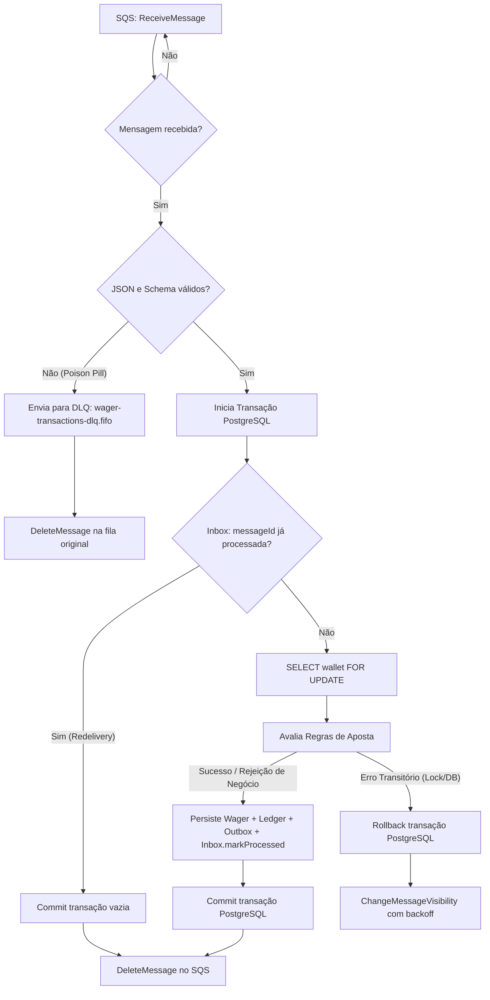

# 📄 Fase 6: SQS Consumer & Inbox Pattern (v0.6.0)

> Especificação técnica da **Fase 6** do Desafio Técnico Jungle Gaming. Implementação do **Consumidor SQS FIFO** para processamento assíncrono de apostas (`wager-transactions.fifo`), integrando o **Inbox Pattern** (`inbox_messages`) com o caso de uso unificado de processamento financeiro, classificação de falhas, roteamento para Dead Letter Queue (DLQ), métricas Prometheus e *graceful shutdown*.

---

## 📌 Metadados

| Campo | Valor |
|---|---|
| **Versão** | v1.0 |
| **Data** | 17/10/2026 |
| **Autor** | Guilherme |
| **Status** | Concluído |
| **Prioridade** | Alta |
| **Tipo** | Feature / Mensageria Distribuída & Idempotência |
| **Versão Alvo** | `0.6.0` |
| **Referência Mestre** | [docs/specs/2026-10-16-distributed-wagering-processor.md](file:///Users/guilherme/testes/jungle_gaming_test/docs/specs/2026-10-16-distributed-wagering-processor.md) |

---

## 📝 Resumo

Implementar o componente **Consumidor SQS FIFO** (`WagerTransactionsConsumerWorker`) para a fila `wager-transactions.fifo`, unificando a ingestão de transações financeiras assíncronas com o mesmo motor contábil utilizado pelos endpoints HTTP (`ProcessWagerTransactionUseCase`). 

O processamento adota o **Inbox Pattern** sobre a tabela PostgreSQL `inbox_messages`, garantindo deduplicação atômica e proteção contra reentregas e falhas em rede (*at-least-once*). Mensagens válidas têm suas operações persistidas atomicamente (wallet, ledger, outbox e inbox) e recebem *ack* (`DeleteMessage`); rejeições de negócio (ex: saldo insuficiente) são registradas no banco e também recebem *ack*; falhas transitórias de infraestrutura mantêm a mensagem na fila com visibilidade ajustada; mensagens com formato ilegível (*poison pills*) são encaminhadas para a DLQ `wager-transactions-dlq.fifo`.

---

## 📦 Escopo

### ✅ Incluído

1. **Envelope de Mensagem SQS & Parser de Validação:**
   - Validação com Zod do corpo da mensagem recebida do SQS:
     - Campos esperados: `idempotencyKey`, `providerId`, `externalTransactionId`, `playerId`, `walletId`, `roundId`, `gameId`, `kind`, `amount`, `currency`, `referenceExternalTransactionId` (opcional).
     - Extração dos atributos do envelope SQS: `MessageId`, `ReceiptHandle`, `ApproximateReceiveCount`.
   - Classificação imediata de JSON inválido ou schema mal formatado como **falha permanente / poison pill**.

2. **Extensão do `ProcessWagerTransactionUseCase` com Suporte a Inbox:**
   - Adição de parâmetro opcional de contexto de mensageria:
     ```typescript
     export interface MessageProcessingContext {
       consumerName: string;
       messageId: string;
     }
     ```
   - Dentro da transação contábil (`em.transactional()`):
     - **Registro de Inbox**: tenta inserir em `inbox_messages` via `repos.inbox.tryInsert(InboxMessage.receive(...))` ou consulta se a mensagem já existe.
     - **Detecção de Reentrega**: se a mensagem já existe e `processedAt !== null`, retorna imediatamente resultado com marcação de replay (`idempotentReplay: true`), sem gerar novos lançamentos contábeis.
     - **Processamento Contábil**: executa as regras normais de negócio (lock pessimista da wallet, idempotência por chave e por transação externa, verificação de saldo, mutação de saldo, registro no ledger, emissão de evento na outbox).
     - **Conclusão de Inbox**: invoca `inboxMessage.markProcessed(now)` e persiste `processed_at` na mesma transação atômica.

3. **Consumidor SQS (`WagerTransactionsConsumerWorker`):**
   - Long polling assíncrono sobre a fila `wager-transactions.fifo` utilizando `@aws-sdk/client-sqs` (`ReceiveMessageCommand` com `WaitTimeSeconds = 20`, `MaxNumberOfMessages = 10`, `VisibilityTimeout = 30`).
   - Ciclo de vida integrado ao NestJS (`OnApplicationBootstrap`, `OnApplicationShutdown`) condicionado a `APP_ROLE` (`APP_ROLE="all"` ou `APP_ROLE="consumer"`).
   - Classificação de resultados:
     - **Sucesso / Replay Idempotente**: chama `DeleteMessageCommand` (ack).
     - **Rejeição de Regra de Negócio** (`INSUFFICIENT_FUNDS`, `REFERENCE_MISMATCH`, etc.): a rejeição já é persistida no PostgreSQL com status `REJECTED` e evento na outbox; a mensagem SQS é considerada tratada com sucesso funcional e deletada via `DeleteMessageCommand`.
     - **Falha Transitória** (erro de banco, timeout de lock, rede indisponível): rollback total da transação SQL, **não faz ack**, chama `ChangeMessageVisibilityCommand` com backoff ou permite expiração natural da visibilidade.
     - **Falha Permanente / Poison Pill** (JSON corrompido, schema inválido não recuperável): despacha para a DLQ `wager-transactions-dlq.fifo` e deleta da fila principal para desobstruir o pipeline.
     - **Redrive Policy Nativa do SQS**: caso retentativas transitórias atinjam `maxReceiveCount = 5`, o próprio SQS move para a DLQ.

4. **Graceful Shutdown:**
   - Em eventos `SIGTERM` / `SIGINT`, encerra o loop de novas chamadas `ReceiveMessage`.
   - Aguarda a conclusão das mensagens em processamento (timeout de até 20 segundos).
   - Para mensagens não concluídas antes do encerramento, invoca `ChangeMessageVisibilityCommand` com `VisibilityTimeout = 0` para devolvê-las imediatamente para a fila.

5. **Observabilidade & Métricas Prometheus:**
   - `sqs_messages_consumed_total{consumer, status}`: contador de mensagens consumidas discriminado por status (`success`, `business_rejection`, `idempotent_replay`, `transient_error`, `poison_pill`).
   - `sqs_processing_duration_seconds{consumer}`: histograma com tempo de processamento das mensagens.
   - `dlq_messages_total{consumer}`: contador de mensagens enviadas para a Dead Letter Queue.
   - Logs estruturados JSON Pino contendo `messageId`, `walletId`, `providerId`, `externalTransactionId`, `attempts` e `durationMs`.

6. **Módulo de Integração:**
   - Registro do worker no [WorkersModule](file:///Users/guilherme/testes/jungle_gaming_test/src/interfaces/workers/workers.module.ts).
   - Atualização da documentação no [README.md](file:///Users/guilherme/testes/jungle_gaming_test/README.md) e visualização das métricas no dashboard de observabilidade.

### ❌ Fora do Escopo

- Resolução assíncrona de referências pendentes com status `PENDING_REFERENCE` (Fase 7: Pending Reference Resolver).
- Orquestrador de testes multi-processo `Bun.spawn` com 3 nós concorrentes (Fase 8).
- Testes de carga sintética via autocannon/k6 (Fase 10).

---

## 🔄 Fluxos Principais



### 🔄 Fluxo 1: Processamento com Sucesso de Mensagem SQS
1. O worker `WagerTransactionsConsumerWorker` recebe uma mensagem de `wager-transactions.fifo` via long polling.
2. Faz o parse do corpo JSON utilizando o schema Zod.
3. Invoca `processWagerTransactionUseCase.execute(idempotencyKey, dto, { consumerName: "wager-transactions-consumer", messageId })`.
4. Dentro de `em.transactional()`:
   - Registra a mensagem na tabela `inbox_messages` (`consumer_name`, `message_id`, `payload_hash`, `received_at`).
   - Obtém lock pessimista `SELECT ... FOR UPDATE` sobre a carteira `walletId`.
   - Verifica idempotência persistente.
   - Aplica a aposta (`BET`/`WIN`/etc.): debita ou credita o saldo, gera lançamento imutável no ledger, agenda evento na outbox.
   - Marca `inbox.markProcessed(now)`.
   - Transação SQL é commitada com sucesso.
5. O worker executa `DeleteMessageCommand` no SQS e registra as métricas de sucesso.

### 🔄 Fluxo 2: Reentrega com Crash Pós-Commit e Pré-Ack (Inbox Deduplication)
1. Uma mensagem $M_1$ é processada com sucesso no PostgreSQL e a transação é commitada.
2. Antes que o comando `DeleteMessage` chegue ao SQS, a instância sofre um crash ou perda de conexão.
3. O visibility timeout (30s) da mensagem expira no SQS.
4. O SQS reentrega $M_1$ para outra instância ou para o worker reiniciado.
5. O worker chama `processWagerTransactionUseCase.execute(...)` com o mesmo `messageId`.
6. Na transação SQL, o caso de uso consulta a tabela `inbox_messages` e constata que `processed_at IS NOT NULL`.
7. O caso de uso retorna imediatamente `{ statusCode: 200, idempotentReplay: true }` sem modificar o saldo da carteira e sem gerar novos lançamentos no ledger.
8. O worker recebe o resultado de replay e executa `DeleteMessageCommand` no SQS.

### 🔄 Fluxo 3: Rejeição de Regra de Negócio (ex: Saldo Insuficiente)
1. A mensagem de aposta solicita um débito de `80.00` em uma carteira com saldo de `50.00`.
2. O caso de uso persiste a transação com `status = 'REJECTED'`, `failure_code = 'INSUFFICIENT_FUNDS'` e gera o evento de outbox correspondente (`WagerTransactionRejected`).
3. O registro na tabela `inbox_messages` é marcado como `processed_at = now`.
4. A transação SQL é commitada.
5. O worker detecta que a rejeição de negócio foi tratada e devidamente auditada no PostgreSQL; executa `DeleteMessageCommand` para retirar a mensagem da fila.

### 🔄 Fluxo 4: Falha Transitória de Infraestrutura
1. Durante o processamento de uma mensagem, ocorre um erro transitório (ex: deadlock detectado no PostgreSQL, timeout de lock ou queda temporária de conexão com o banco).
2. A transação SQL sofre rollback completo.
3. O worker captura a exceção de infraestrutura e **não** chama `DeleteMessage`.
4. O worker calcula um delay de backoff proporcional a `ApproximateReceiveCount` e ajusta a visibilidade da mensagem através de `ChangeMessageVisibilityCommand`.
5. Se a mensagem falhar repetidamente até `ApproximateReceiveCount > 5`, a redrive policy configurada no SQS encaminha a mensagem automaticamente para `wager-transactions-dlq.fifo`.

### 🔄 Fluxo 5: Falha Permanente / Poison Pill
1. Uma mensagem corrompida (JSON inválido, campos essenciais nulos ou formato ilegível) chega à fila.
2. O parser Zod falha na validação inicial.
3. O worker classifica a falha como permanente: envia a mensagem para a DLQ `wager-transactions-dlq.fifo` (com atributos de erro anexados) e executa `DeleteMessageCommand` na fila principal.
4. Incrementa o contador `dlq_messages_total` e emite log de alerta.

---

## 📐 Regras e Restrições

### Regras de Negócio

1. **Atomicidade Total:** O registro na tabela `inbox_messages`, a mutação do saldo na tabela `wallets`, a criação do lançamento contábil em `wallet_ledger_entries`, o registro da transação em `wager_transactions` e o evento em `outbox_messages` devem ocorrer rigorosamente na mesma transação SQL (`em.transactional()`).
2. **Sem Duplicidade de Lançamentos:** Uma mensagem reentregue pelo SQS jamais pode produzir novo débito, novo crédito ou novo lançamento no ledger.
3. **Rejeição de Negócio é Resolução:** Transações rejeitadas por regras de domínio (`INSUFFICIENT_FUNDS`, `REFERENCE_MISMATCH`, etc.) são salvas como `REJECTED` e dão *ack* na fila SQS. Elas **não** devem ser reenviadas em loop nem encaminhadas para a DLQ como se fossem falhas de sistema.
4. **Isolamento por Carteira:** Mensagens na fila FIFO devem utilizar `MessageGroupId = walletId` para otimização de concorrência por agrupamento, mantendo o lock pessimista `SELECT ... FOR UPDATE` no banco de dados como garantia final e soberana.

### Restrições Técnicas / Funcionais

1. **Sem Tipos Primitivos para Dinheiro:** É terminantemente proibido utilizar `number` ou `float` para qualquer manipulação monetária. Utilizar estritamente o Value Object [Money](file:///Users/guilherme/testes/jungle_gaming_test/src/domain/money/money.ts).
2. **Sem Cache em Memória para Idempotência:** A deduplicação deve ser 100% garantida pela persistência relacional do PostgreSQL através da tabela `inbox_messages` e chaves únicas de `wager_transactions`.
3. **Compatibilidade com APP_ROLE:** O consumidor só deve iniciar se `APP_ROLE` for `"all"` ou `"consumer"`. Em instâncias com `APP_ROLE="api"` ou `APP_ROLE="outbox"`, o consumidor deve permanecer inativo.
4. **Driver AWS SQS Oficial:** Utilizar `@aws-sdk/client-sqs` com suporte ao endpoint customizado (`AWS_ENDPOINT_URL`) para funcionamento perfeito tanto em ambiente LocalStack quanto AWS real.
5. **Proibido Executar Migrations:** Não executar comandos de migration sem permissão explícita do usuário. (O schema `inbox_messages` já foi criado na migration inicial).

---

## ✅ Critérios de Aceite

- [x] Quando uma mensagem válida de `BET` for publicada na fila `wager-transactions.fifo`, o worker deve consumi-la, debitar o saldo da carteira, gerar a entrada no ledger, criar o evento na outbox, registrar no inbox e remover a mensagem do SQS via `DeleteMessage`.
- [x] Quando uma mensagem com `BET` superior ao saldo for consumida, o worker deve persistir a transação com `status = 'REJECTED'`, gravar o evento na outbox, salvar o inbox e remover a mensagem da fila com sucesso (`ack`).
- [x] Quando uma mensagem for reentregue após crash antes do *ack*, o consumidor deve identificar o registro na tabela `inbox_messages` e executar o *ack* no SQS sem alterar o saldo e sem duplicar o ledger.
- [x] Quando uma mensagem com JSON inválido ou schema corrompido chegar à fila (*poison pill*), o worker deve enviá-la para a DLQ `wager-transactions-dlq.fifo` e deletá-la da fila principal.
- [x] Quando a aplicação receber `SIGTERM`, o worker deve parar de buscar novas mensagens, concluir as mensagens pendentes em até 20 segundos e liberar a visibilidade daquelas que não concluírem a tempo.
- [x] As métricas Prometheus (`sqs_messages_consumed_total`, `sqs_processing_duration_seconds`, `dlq_messages_total`) devem refletir com precisão cada operação realizada.
- [x] Todos os testes automatizados (unitários e de integração com PostgreSQL e LocalStack SQS reais) devem passar sem falhas e com tempo de execução rápido.

---

## 🧩 Impacto Técnico

### Módulos / Camadas Impactadas

- **Domain / Messaging:**
  - [InboxMessage](file:///Users/guilherme/testes/jungle_gaming_test/src/domain/messaging/inbox-message.ts) (já existente).
- **Application:**
  - [ProcessWagerTransactionUseCase](file:///Users/guilherme/testes/jungle_gaming_test/src/application/use-cases/process-wager-transaction.use-case.ts) (adicionar contexto opcional de `MessageProcessingContext`).
  - [InboxRepository](file:///Users/guilherme/testes/jungle_gaming_test/src/application/ports/repositories.port.ts) (utilizar métodos existentes).
- **Infrastructure:**
  - Criação de `SqsConsumerMetrics` em `src/infrastructure/observability/sqs-consumer-metrics.ts`.
  - Módulo / cliente SQS para consumo e DLQ.
- **Interfaces / Workers:**
  - Criação de `WagerTransactionsConsumerWorker` em `src/interfaces/workers/wager-transactions-consumer.worker.ts`.
  - Registro no [WorkersModule](file:///Users/guilherme/testes/jungle_gaming_test/src/interfaces/workers/workers.module.ts).
- **Testes:**
  - Criação de testes de unidade em `test/unit/wager-transactions-consumer.worker.test.ts`.
  - Criação de testes de integração em `test/integration/sqs-consumer.integration.test.ts`.

### Arquivos Prováveis

- `src/application/use-cases/process-wager-transaction.use-case.ts`
- `src/infrastructure/observability/sqs-consumer-metrics.ts`
- `src/interfaces/workers/wager-transactions-consumer.worker.ts`
- `src/interfaces/workers/workers.module.ts`
- `src/interfaces/http/views/metrics-dashboard.html.ts` (adicionar cards de métricas do consumidor SQS)
- `test/unit/wager-transactions-consumer.worker.test.ts`
- `test/integration/sqs-consumer.integration.test.ts`

### Dependências

- `@aws-sdk/client-sqs` (já instalado e utilizado na Fase 5)
- `zod` (já instalado)
- `prom-client` (já instalado)

---

## 🧭 Plano de Implementação

1. **Ajuste no Use Case Contábil (`ProcessWagerTransactionUseCase`):**
   - Suportar `context?: MessageProcessingContext` (`{ consumerName: string; messageId: string }`).
   - Dentro da transação, se houver contexto de mensageria:
     - Consultar `repos.inbox.find(context.consumerName, context.messageId)`.
     - Se existir e estiver processada, retornar `REPLAY` idempotente imediatamente.
     - Se não existir, criar e salvar `InboxMessage.receive(...)` e, ao final do processamento das regras, invocar `inbox.markProcessed(now)`.
2. **Criação das Métricas do Consumidor SQS:**
   - Criar `src/infrastructure/observability/sqs-consumer-metrics.ts` com contadores de mensagens consumidas, histograma de duração e contador de DLQ.
3. **Criação do Worker Consumidor SQS (`WagerTransactionsConsumerWorker`):**
   - Implementar polling assíncrono com `@aws-sdk/client-sqs` (`ReceiveMessageCommand`, `DeleteMessageCommand`, `ChangeMessageVisibilityCommand`, `SendMessageCommand` para DLQ).
   - Validador de envelope com Zod e classificação de erro (negócio vs transitório vs permanente).
   - Implementar ciclo de vida com `OnApplicationBootstrap` e `OnApplicationShutdown`.
4. **Registro no `WorkersModule`:**
   - Adicionar o worker no módulo condicionado à role (`APP_ROLE="all"` ou `APP_ROLE="consumer"`).
5. **Atualização do Dashboard Visual & Documentação:**
   - Adicionar estatísticas de consumo SQS ao dashboard em `src/interfaces/http/views/metrics-dashboard.html.ts`.
   - Atualizar a documentação do `README.md`.
6. **Suíte de Testes Automatizados:**
   - Testes unitários para validação de payloads, tratamento de erros e chamadas do consumidor.
   - Testes de integração cobrindo fluxos reais com LocalStack e PostgreSQL (sucesso, saldo insuficiente, redelivery com inbox, poison pill para DLQ).
7. **Validação de Qualidade:**
   - Executar `bun run check` (sem erros de linter, sem `number` para dinheiro, 100% dos testes passando).

---

## 🧪 Testes Esperados

### Unidade
- [x] Validação do envelope Zod: rejeita payloads incompletos, tipos errados ou JSON inválido.
- [x] Comportamento do use case com contexto de inbox: retorna replay se a mensagem já foi processada anteriormente.
- [x] Classificação de exceções: diferenciação nítida entre falhas transitórias, rejeições de domínio e poison pills.

### Integração (PostgreSQL + LocalStack SQS reais)
- [x] **Fluxo ponta a ponta:** postar mensagem na fila `wager-transactions.fifo` -> worker consome -> wallet debitada -> ledger registrado -> evento gerado no outbox -> mensagem deletada do SQS.
- [x] **Rejeição contábil:** saldo insuficiente resulta em transação `REJECTED`, outbox gerado e mensagem devidamente removida da fila SQS.
- [x] **Redelivery & Inbox:** mensagem reentregue pelo SQS é reconhecida pelo `inbox_messages`, não duplica lançamentos no ledger nem no saldo, e é deletada com sucesso.
- [x] **Poison Pill:** mensagem corrompida enviada à fila de entrada é movida para a DLQ `wager-transactions-dlq.fifo` e removida da fila principal.
- [x] **Graceful Shutdown:** parada limpa devolvendo visibilidade de mensagens não finalizadas.

---

## 🤖 Instruções para IA

### Objetivo Operacional
> Implemente rigorosamente o escopo desta spec (Fase 6), preservando a integridade das invariantes financeiras e os padrões arquiteturais estabelecidos nas fases anteriores.

### O que a IA deve entregar
- Código funcional com TypeScript estrito (`strict: true`, sem `any` desnecessário).
- Testes unitários e de integração verdes e rápidos.
- Zero uso de `number`/`float` para dinheiro (verificado por `bun run check:money`).
- Resumo claro das alterações efetuadas.

### Observações específicas desta spec
- **NÃO fazer commit** sem a permissão explícita do usuário.
- **NÃO rodar migrations** sem permissão (a tabela `inbox_messages` já está presente no schema do banco).
- **NÃO abrir navegador** para debug visual.
- Mensagens de negócio rejeitadas (`INSUFFICIENT_FUNDS`, etc.) devem dar `ack` (`DeleteMessage`), pois já foram salvas e auditadas no banco de dados.

---

## 📁 Pós-execução da Spec

Quando o usuário pedir para executar uma spec, assim que todas as instruções da spec em questão forem concluídas, mova o arquivo da spec para a pasta `docs/executed/`.
