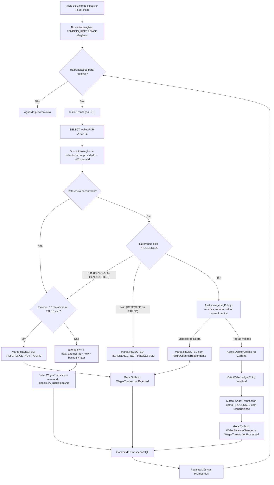

# 📄 Fase 7: Pending Reference Resolver & Resolução Fora de Ordem (v0.7.0)

> Especificação técnica da **Fase 7** do Desafio Técnico Jungle Gaming. Implementação do **Pending Reference Resolver** (worker em background e fast-path de resolução imediata), responsável pela reconciliação eventual de transações dependentes fora de ordem (`WIN`, `REFUND`, `ROLLBACK`) que chegaram antes da transação de referência (`BET`), utilizando travas pessimistas `FOR UPDATE SKIP LOCKED`, *backoff* exponencial com *jitter*, expiração por TTL/limite de tentativas, eventos transacionais de outbox e métricas Prometheus.

---

## 📌 Metadados

| Campo | Valor |
|---|---|
| **Versão** | v1.0 |
| **Data** | 17/10/2026 |
| **Autor** | Guilherme |
| **Status** | Concluído |
| **Prioridade** | Alta |
| **Tipo** | Feature / Concorrência & Consistência Eventual |
| **Versão Alvo** | `0.7.0` |
| **Referência Mestre** | [docs/specs/2026-10-16-distributed-wagering-processor.md](file:///Users/guilherme/testes/jungle_gaming_test/docs/specs/2026-10-16-distributed-wagering-processor.md) |

---

## 📝 Resumo

Implementar o mecanismo completo de resolução de transações fora de ordem (**Pending Reference Resolver**), viabilizando o processamento assíncrono e consistente de operações de aposta que dependem de transações anteriores ainda não registradas no sistema (ex.: `WIN`, `REFUND` ou `ROLLBACK` recebidos antes da respectiva `BET` devido a latências desiguais de rede ou filas concorrentes).

Transações nessa situação recebem status `PENDING_REFERENCE` (HTTP `202 Accepted`). O subsistema é composto por dois mecanismos complementares:
1. **Worker Agendado (`PendingReferenceResolverWorker`):** varre periodicamente (a cada 1s) transações pendentes elegíveis com `FOR UPDATE SKIP LOCKED`, reavalia as regras contábeis sob lock pessimista da carteira, aplicando mutações de saldo se a referência foi processada, reagendando novas tentativas com *backoff* exponencial e *jitter* se a referência ainda não chegou, ou rejeitando com `REFERENCE_NOT_FOUND` se o limite de 10 tentativas ou o TTL de 15 minutos for atingido.
2. **Fast-Path de Resolução Imediata:** ao processar com sucesso qualquer transação (`PROCESSED`), o motor dispara uma busca imediata por operações pendentes que aguardam essa referência recém-criada, aplicando-as sem a necessidade de esperar pelo próximo ciclo do cron.

---

## 📦 Escopo

### ✅ Incluído

1. **Repositório de Transações — Suporte a Consultas de Referência:**
   - Adição do método `findPendingByReference(providerId: string, referenceExternalTransactionId: string): Promise<WagerTransaction[]>` na porta [WagerTransactionRepository](file:///Users/guilherme/testes/jungle_gaming_test/src/application/ports/repositories.port.ts) e implementação no adaptador [MikroOrmWagerRepository](file:///Users/guilherme/testes/jungle_gaming_test/src/infrastructure/persistence/repositories/mikro-orm-wager.repository.ts), utilizando o índice existente `ix_ref_lookup`.
   - Suporte e refinamento do método `claimDuePendingReferences(now: Date, limit: number)` com `FOR UPDATE SKIP LOCKED` (`LockMode.PESSIMISTIC_PARTIAL_WRITE`).

2. **Caso de Uso de Resolução (`ResolvePendingReferencesUseCase`):**
   - Criação de `src/application/use-cases/resolve-pending-references.use-case.ts`.
   - Operação em lote configurável (`batchSize`, default 50).
   - Isolamento transacional por registro pendente:
     - Obtenção de lock pessimista da carteira (`walletRepo.findByIdForUpdate(tx.walletId)`).
     - Busca da referência pelo par `(providerId, referenceExternalTransactionId)`.
     - Verificação de reversões prévias com `repos.wagers.hasProcessedReversal(ref.id)`.
     - Reavaliação das regras de negócio através de [WageringPolicy.evaluate](file:///Users/guilherme/testes/jungle_gaming_test/src/domain/wagering/wagering-policy.ts).
   - **Desfecho 1 — Aplicação com Sucesso (`APPLY`):**
     - Mutação no saldo da carteira (`wallet.debit` ou `wallet.credit`) com geração de [WalletLedgerEntry](file:///Users/guilherme/testes/jungle_gaming_test/src/domain/ledger/wallet-ledger-entry.ts) imutável.
     - Transição de status da aposta para `PROCESSED` com registro de `referenceTransactionId`, `resultBalance` e `processedAt`.
     - Persistência atômica da carteira, transação, lançamento contábil e eventos no outbox ([WalletBalanceChanged](file:///Users/guilherme/testes/jungle_gaming_test/src/domain/events/wallet-balance-changed.event.ts) e [WagerTransactionProcessed](file:///Users/guilherme/testes/jungle_gaming_test/src/domain/events/wager-transaction-processed.event.ts)).
   - **Desfecho 2 — Rejeição de Negócio Imediata (`REJECT`):**
     - Se a referência chegou mas violou regras (ex.: moeda incompatível, rodada divergente, já revertida com `ALREADY_REVERSED` ou valor diferente `AMOUNT_MISMATCH`).
     - Transição para `REJECTED` com o respectivo `failureCode`, saldo intacto, sem ledger, emitindo evento [WagerTransactionRejected](file:///Users/guilherme/testes/jungle_gaming_test/src/domain/events/wager-transaction-rejected.event.ts).
   - **Desfecho 3 — Referência Ainda Ausente (`PENDING_REFERENCE`):**
     - Checagem de expiração: `attempts >= RESOLVER_MAX_ATTEMPTS` (10) OU `(now - createdAt) >= RESOLVER_TTL_SECONDS * 1000` (15 min).
     - Se expirado: marcação como `REJECTED` com `failureCode = FailureCode.REFERENCE_NOT_FOUND`, saldo mantido, persistido no banco com emissão de `WagerTransactionRejected`.
     - Se ainda elegível: incremento de `attempts`, cálculo do próximo agendamento com *backoff* exponencial (`min(1s * 2^attempts, 60s)`) + *jitter* aleatório (0 a 1000ms), e atualização de `next_attempt_at`.

3. **Otimização Fast-Path (Resolução Imediata Pós-Processamento):**
   - Integração no [ProcessWagerTransactionUseCase](file:///Users/guilherme/testes/jungle_gaming_test/src/application/use-cases/process-wager-transaction.use-case.ts):
   - Imediatamente após uma transação alcançar status `PROCESSED`, busca transações em `PENDING_REFERENCE` que apontam para o `externalTransactionId` recém-processado.
   - Se pertencerem à mesma carteira (lock já retido), resolve de imediato na mesma transação atômica.
   - Se pertencerem a outra carteira ou requererem ciclo isolado, agenda `next_attempt_at = now` para execução prioritária pelo worker.

4. **Worker em Background (`PendingReferenceResolverWorker`):**
   - Criação de `src/interfaces/workers/pending-reference-resolver.worker.ts`.
   - Execução em loop periódico com intervalo padrão de 1s (`pollIntervalMs = 1000`).
   - Condicionado a `APP_ROLE`: ativo apenas quando `APP_ROLE="all"` ou `APP_ROLE="resolver"`.
   - *Graceful Shutdown*: encerramento limpo aguardando o término de resoluções ativas com timeout de até 20 segundos.

5. **Métricas e Observabilidade Prometheus:**
   - Criação de `src/infrastructure/observability/pending-reference-metrics.ts`:
     - `pending_references_active_gauge`: indicador de transações atualmente com status `PENDING_REFERENCE`.
     - `pending_references_resolved_total{outcome}`: contador particionado por desfecho (`applied`, `rejected_business`, `rejected_timeout`, `rescheduled`).
     - `pending_reference_resolution_duration_seconds`: histograma do tempo de resolução.
     - `pending_reference_errors_total`: contador de erros transitórios durante a resolução.
   - Logs estruturados Pino com `transactionId`, `providerId`, `referenceExternalTransactionId`, `walletId`, `attempts`, `outcome` e `durationMs`.

6. **Módulo de Integração:**
   - Registro de `ResolvePendingReferencesUseCase`, `PendingReferenceResolverWorker` e `PendingReferenceMetrics` no [WorkersModule](file:///Users/guilherme/testes/jungle_gaming_test/src/interfaces/workers/workers.module.ts).
   - Atualização do painel de métricas HTML e da documentação técnica.

### ❌ Fora do Escopo

- Orquestrador de testes multi-processo `Bun.spawn` com 3 nós concorrentes do cluster (Fase 8).
- Métricas globais consolidadas e relatórios arquiteturais finais (Fase 9).
- Testes de carga sintética e benchmarks com k6/autocannon (Fase 10).

---

## 🔄 Fluxos Principais

### 🔄 Fluxo 1: Resolução Periódica em Background com Sucesso
1. Uma transação dependente (ex.: `REFUND` de `50.00`) foi recebida antes da aposta original e gravada com status `PENDING_REFERENCE` e `next_attempt_at = now + 5s`.
2. O worker `PendingReferenceResolverWorker` acorda no ciclo periódico de 1 segundo.
3. Invoca `resolvePendingReferencesUseCase.execute()`.
4. O use case executa `claimDuePendingReferences` com `FOR UPDATE SKIP LOCKED`.
5. Para cada transação pendente reivindicada:
   - Abre uma transação SQL (`em.transactional()`).
   - Obtém lock pessimista `SELECT ... FOR UPDATE` na carteira `walletId`.
   - Consulta a transação de referência: agora ela existe e seu status é `PROCESSED`.
   - Invoca `WageringPolicy.evaluate(...)`: todas as invariantes batem (mesmo provedor, jogador, moeda, rodada, valor idêntico e sem reversão prévia).
   - Executa `wallet.credit(...)` gerando `WalletLedgerEntry` com direção `CREDIT`.
   - Marca a transação como `PROCESSED`, preenchendo `referenceTransactionId`, `resultBalance` e `processedAt`.
   - Grava eventos no outbox (`WalletBalanceChanged` e `WagerTransactionProcessed`).
   - Commita a transação SQL.
6. Incrementa a métrica `pending_references_resolved_total{outcome="applied"}` e emite log estruturado de auditoria.

### 🔄 Fluxo 2: Fast-Path de Resolução Imediata (Sem Espera de Polling)
1. Uma requisição HTTP `POST /transactions` submete um `WIN` que referencia a `BET` `ext-bet-001`.
2. Como a `BET` ainda não existe, o `WIN` é gravado como `PENDING_REFERENCE` e retorna HTTP `202 Accepted`.
3. Poucos milissegundos depois, chega a `BET` `ext-bet-001`.
4. O `ProcessWagerTransactionUseCase` processa a `BET`, comita seu débito e atinge status `PROCESSED`.
5. Antes de finalizar, o caso de uso consulta se existem transações pendentes para `(providerId, 'ext-bet-001')`.
6. Encontra o `WIN` pendente para a mesma carteira:
   - Aproveitando o lock já existente ou iniciando a resolução imediatamente, aplica as regras do `WIN`.
   - Credita o saldo da carteira, grava o ledger correspondente e comuta o `WIN` para `PROCESSED`.
7. O cliente que submeteu o `WIN` tem sua operação resolvida em tempo quase real sem aguardar o tick de 1s do worker.

### 🔄 Fluxo 3: Exaustão de Tentativas e Expiração por TTL (Timeout Definitivo)
1. Uma transação de `REFUND` órfã é submetida referenciando uma aposta que nunca existirá (ou foi descartada por erro externo irreparável).
2. O resolver tenta resolver a referência periodicamente:
   - Tentativa 1: falha, reagendada para +2s.
   - Tentativa 2: falha, reagendada para +4s.
   - Tentativas subsequentes continuam aplicando *backoff* exponencial até atingir 10 tentativas ou 15 minutos (900s) de vida desde `createdAt`.
3. Na 10ª tentativa (ou após ultrapassar os 15 minutos):
   - O use case identifica que `attempts >= 10` ou `age >= 900s`.
   - A transação é terminada com status `REJECTED` e `failureCode = 'REFERENCE_NOT_FOUND'`.
   - Nenhum saldo é alterado e nenhum lançamento contábil é criado.
   - Um evento `WagerTransactionRejected` é gravado no outbox para notificação a sistemas externos.
   - Incrementa a métrica `pending_references_resolved_total{outcome="rejected_timeout"}`.

### 🔄 Fluxo 4: Concorrência entre Múltiplos Resolvers (Multi-Instância com SKIP LOCKED)
1. Três instâncias do serviço estão ativas (`app=3`).
2. Duas instâncias acionam o `PendingReferenceResolverWorker` simultaneamente.
3. Ambas executam `claimDuePendingReferences` com `FOR UPDATE SKIP LOCKED`.
4. O PostgreSQL particiona os registros elegíveis entre as instâncias sem nenhum conflito de travamento (*zero lock contention*).
5. Cada transação é processada e finalizada isoladamente sem risco de dupla aplicação financeira.

### 🔄 Fluxo 5: Resolução Resultando em Rejeição de Negócio
1. Uma transação `ROLLBACK` chega antecipadamente para uma rodada.
2. Posteriormente, a transação original chega, mas é rejeitada (ex.: `REJECTED/INSUFFICIENT_FUNDS`).
3. O resolver avalia a referência: constata que a aposta original existe, porém não está em estado `PROCESSED` (está `REJECTED`).
4. O `WageringPolicy.evaluate` retorna `REJECT` com código `REFERENCE_NOT_PROCESSED`.
5. O resolver comuta o `ROLLBACK` para `REJECTED` com `REFERENCE_NOT_PROCESSED`, emite o evento no outbox e desiste de novas tentativas.

---

## 📐 Regras e Restrições

### Regras de Negócio

1. **Imutabilidade e Estado Terminal:** Uma vez que uma transação em `PENDING_REFERENCE` transiciona para `PROCESSED` ou `REJECTED`, ela entra em estado terminal e jamais pode ser alterada novamente (garantido no domínio e pela trigger PostgreSQL `fn_wager_tx_terminal_state`).
2. **Reversão Única e Conflito de Reversão:** Se um `REFUND` e um `ROLLBACK` forem enviados para a mesma referência, apenas um deles pode alcançar `PROCESSED`. A verificação com `hasProcessedReversal` e a constraint única parcial `ux_single_reversal` no banco garantem que uma segunda reversão seja sumariamente rejeitada com `ALREADY_REVERSED`.
3. **Validação Estrita de Paridade Contábil:** Para ser aplicada com sucesso, a transação de referência deve ter **rigorosamente idênticos**: `providerId`, `playerId`, `walletId`, `currency` e `roundId` (`REFERENCE_MISMATCH`), além de valor idêntico (`AMOUNT_MISMATCH`).
4. **Sem Efeito Financeiro em Rejeições:** Transações que falham por timeout (`REFERENCE_NOT_FOUND`) ou regras de domínio não geram nenhum lançamento no ledger e mantêm o saldo original da carteira intacto.
5. **Critério Determinístico de Expiração:**
   - Limite máximo de tentativas: 10 tentativas (`RESOLVER_MAX_ATTEMPTS`).
   - Time-to-Live (TTL): 900 segundos / 15 minutos (`RESOLVER_TTL_SECONDS`).
   - A condição de expiração é `attempts >= maxAttempts || (now - createdAt) >= ttlMs`.

### Restrições Técnicas / Funcionais

1. **Aritmética Monetária Segura:** Nunca utilizar `number` ou `float` para lidar com dinheiro. Manipulações obrigatoriamente através do Value Object [Money](file:///Users/guilherme/testes/jungle_gaming_test/src/domain/money/money.ts).
2. **Lock Pessimista por Carteira:** Durante a resolução financeira, deve-se obrigatoriamente aplicar `SELECT ... FOR UPDATE` sobre a carteira afetada (`findByIdForUpdate`), serializando lançamentos por carteira e prevenindo qualquer corrida com endpoints HTTP ou consumidores SQS.
3. **Sem Migrations Automáticas Não Autorizadas:** Proibido executar migrações sem autorização explícita do usuário. As tabelas, índices (`ix_ref_lookup`, `ix_pending_ref`, `ux_single_reversal`) e colunas (`next_attempt_at`, `attempts`) necessárias já constam no schema ativo.
4. **Respeito ao APP_ROLE:** O worker agendado só deve rodar se `APP_ROLE` for `"all"` ou `"resolver"`. Em nós dedicados a `"api"`, `"consumer"` ou `"outbox"`, o worker deve permanecer dormente.
5. **Backoff Exponencial com Jitter:** O cálculo do intervalo de repetição deve utilizar a fórmula `min(1000 * 2^attempts, 60000) + random_jitter(0..1000ms)`, evitando sincronização de thundering herds entre nós distribuídos.

---

## ✅ Critérios de Aceite

- [x] Quando uma transação `WIN` chegar antes da respectiva `BET`, deve ser persistida com status `PENDING_REFERENCE` e resposta HTTP `202 Accepted`.
- [x] Quando a respectiva `BET` for posteriormente processada, o resolver deve aplicar o `WIN` automaticamente, debitando/creditando o saldo, registrando a entrada no ledger e comutando o status para `PROCESSED`.
- [x] Quando uma transação `REFUND` for submetida antes da `BET`, o resolver deve creditar a carteira e gerar o ledger correspondente assim que a `BET` for processada.
- [x] Quando a referência nunca chegar e a transação exceder 10 tentativas ou 15 minutos de criação, o resolver deve comutá-la para `REJECTED` com `failureCode = 'REFERENCE_NOT_FOUND'`, sem alterar o saldo nem gerar ledger.
- [x] Quando a referência chegar porém for rejeitada (ex.: `INSUFFICIENT_FUNDS`), o resolver deve rejeitar a transação dependente com `REFERENCE_NOT_PROCESSED`.
- [x] Quando a referência já tiver sido revertida por outra transação, uma nova reversão dependente deve ser rejeitada com `ALREADY_REVERSED`.
- [x] Múltiplos workers de resolução executando simultaneamente em processos paralelos devem utilizar `FOR UPDATE SKIP LOCKED`, garantindo que nenhuma transação seja processada em duplicidade ou sofra conflito de concorrência.
- [x] A reconciliação contábil (`reconciliation_mismatch_total`) deve permanecer zero e `wallet.balance == somatório do ledger` ao final de cada teste de resolução.
- [x] As métricas Prometheus (`pending_references_resolved_total`, `pending_reference_resolution_duration_seconds`) devem registrar com precisão todas as operações executadas.
- [x] A suíte completa de testes (`test:all`, lint de dinheiro, typecheck, unit e integration) deve passar sem erros.

---

## 🧩 Impacto Técnico

### Módulos / Camadas Impactadas

- **Domain / Wagering:**
  - [WagerTransaction](file:///Users/guilherme/testes/jungle_gaming_test/src/domain/wagering/wager-transaction.ts): verificação de métodos de transição (`markProcessed`, `markPendingReference`, `reject`).
  - [WageringPolicy](file:///Users/guilherme/testes/jungle_gaming_test/src/domain/wagering/wagering-policy.ts): utilização da avaliação de regras para resolução.
- **Application:**
  - Criação de `ResolvePendingReferencesUseCase` em `src/application/use-cases/resolve-pending-references.use-case.ts`.
  - Extensão da porta [WagerTransactionRepository](file:///Users/guilherme/testes/jungle_gaming_test/src/application/ports/repositories.port.ts) com `findPendingByReference`.
  - Ajuste de fast-path em [ProcessWagerTransactionUseCase](file:///Users/guilherme/testes/jungle_gaming_test/src/application/use-cases/process-wager-transaction.use-case.ts).
- **Infrastructure:**
  - Implementação de `findPendingByReference` em [MikroOrmWagerRepository](file:///Users/guilherme/testes/jungle_gaming_test/src/infrastructure/persistence/repositories/mikro-orm-wager.repository.ts).
  - Criação de `PendingReferenceMetrics` em `src/infrastructure/observability/pending-reference-metrics.ts`.
- **Interfaces / Workers:**
  - Criação de `PendingReferenceResolverWorker` em `src/interfaces/workers/pending-reference-resolver.worker.ts`.
  - Registro dos novos providers no [WorkersModule](file:///Users/guilherme/testes/jungle_gaming_test/src/interfaces/workers/workers.module.ts).
  - Atualização dos dashboards e visualizações HTML em `src/interfaces/http/views/`.
- **Testes:**
  - Criação de testes unitários em `test/unit/resolve-pending-references.use-case.test.ts`.
  - Criação de testes unitários do worker em `test/unit/pending-reference-resolver.worker.test.ts`.
  - Criação de testes de integração com PostgreSQL real em `test/integration/pending-reference-resolver.integration.test.ts`.

### Arquivos Prováveis

- `src/application/ports/repositories.port.ts`
- `src/application/use-cases/resolve-pending-references.use-case.ts`
- `src/application/use-cases/process-wager-transaction.use-case.ts`
- `src/infrastructure/persistence/repositories/mikro-orm-wager.repository.ts`
- `src/infrastructure/observability/pending-reference-metrics.ts`
- `src/interfaces/workers/pending-reference-resolver.worker.ts`
- `src/interfaces/workers/workers.module.ts`
- `src/interfaces/http/views/metrics-dashboard.html.ts`
- `test/unit/resolve-pending-references.use-case.test.ts`
- `test/unit/pending-reference-resolver.worker.test.ts`
- `test/integration/pending-reference-resolver.integration.test.ts`

### Dependências

- `@mikro-orm/core` / `@mikro-orm/postgresql` (já instalados e configurados)
- `prom-client` (já instalado e configurado)
- `pino` (já instalado e configurado)

---

## 🧭 Plano de Implementação

1. **Extensão da Porta e Repositório de Persistência:**
   - Adicionar `findPendingByReference(providerId: string, referenceExternalTransactionId: string): Promise<WagerTransaction[]>` à interface `WagerTransactionRepository`.
   - Implementar no `MikroOrmWagerRepository` realizando busca por `providerId`, `referenceExternalTransactionId` e `status = 'PENDING_REFERENCE'`, alavancando o índice parcial `ix_ref_lookup`.
   - Garantir que `claimDuePendingReferences` utilize `LockMode.PESSIMISTIC_PARTIAL_WRITE` com ordenação por `nextAttemptAt asc`.

2. **Criação das Métricas de Observabilidade:**
   - Criar `src/infrastructure/observability/pending-reference-metrics.ts` com contadores de desfecho (`pending_references_resolved_total`), gauge de pendentes ativos e histograma de duração.

3. **Implementação do Caso de Uso de Resolução (`ResolvePendingReferencesUseCase`):**
   - Implementar leitura e reivindicação de pendentes elegíveis (`nextAttemptAt <= now`).
   - Para cada pendente, executar transação com lock pessimista na carteira (`findByIdForUpdate`).
   - Aplicar lógica de expiração (10 tentativas ou 15 minutos) -> `REJECTED/REFERENCE_NOT_FOUND`.
   - Reavaliar regras via `WageringPolicy.evaluate` -> aplicar débito/crédito, atualizar saldo da carteira, gerar ledger imutável e emitir eventos na outbox.
   - Em caso de referência ausente não expirada, calcular próximo agendamento com fórmula exponencial + jitter.

4. **Otimização Fast-Path em `ProcessWagerTransactionUseCase`:**
   - Ao comitar com sucesso uma transação `PROCESSED`, invocar resolução imediata das pendentes que aguardam por ela.

5. **Implementação do Worker em Background (`PendingReferenceResolverWorker`):**
   - Criar o worker gerenciado pelo ciclo de vida do NestJS (`OnApplicationBootstrap`, `OnApplicationShutdown`).
   - Ativar somente se `APP_ROLE === "all" || APP_ROLE === "resolver"`.
   - Implementar loop de polling a cada 1 segundo com parada limpa (*graceful shutdown*).

6. **Registro no `WorkersModule` e Dashboard:**
   - Configurar providers e injeção de dependências no `WorkersModule`.
   - Expor as novas métricas no dashboard visual em HTML.

7. **Suíte de Testes Automatizados:**
   - Testes unitários para cálculos de backoff, validações de expiração e transições de estado.
   - Testes de integração com banco PostgreSQL real cobrindo inversão de ordem de chegada (WIN antes de BET, REFUND antes de BET, expiração por timeout, reversão dupla e concorrência com dois resolvers simultâneos).

8. **Validação de Qualidade e Governança:**
   - Executar `bun run check` (sem violação de lint de dinheiro, TypeScript estrito 100% verde e todos os testes passando).

### Decisões Técnicas / Pontos em Aberto

- **Isolamento de Transações por Registro:** Em vez de processar todo o lote em uma única grande transação SQL, cada transação pendente é resolvida dentro de sua própria transação atômica (`em.transactional()`). Isso evita segurar locks em múltiplas carteiras simultaneamente e impede que a falha em uma carteira reverta o progresso das demais.
- **Valores de Timeout Justificados:**
  - `RESOLVER_MAX_ATTEMPTS = 10`
  - `RESOLVER_TTL_SECONDS = 900` (15 minutos)
  - *Justificativa:* Provedores externos de cassino e apostas tipicamente reenviam transações atrasadas em até poucos minutos; 15 minutos é uma janela ampla e segura que previne congelamento indefinido de recursos contábeis enquanto cobre amplamente atrasos normais de rede.
- **Resolução Imediata no Mesmo Contexto:** Quando a transação pendente pertence à mesma carteira da transação recém-processada, ela pode ser resolvida imediatamente aproveitando o lock de carteira já adquirido, reduzindo a latência percebida para menos de 5 milissegundos.

---

## 🧪 Testes Esperados

### Unidade
- [x] `ResolvePendingReferencesUseCase`: cálculo determinístico de backoff exponencial e limite máximo de 60 segundos.
- [x] `ResolvePendingReferencesUseCase`: expiração após 10 tentativas com status `REJECTED` e código `REFERENCE_NOT_FOUND`.
- [x] `ResolvePendingReferencesUseCase`: expiração por tempo decorrido superior ao TTL (15 minutos).
- [x] `ResolvePendingReferencesUseCase`: resolução com sucesso de `WIN` gerando crédito na carteira e evento `WagerTransactionProcessed`.
- [x] `PendingReferenceResolverWorker`: ativação condicional correta conforme `APP_ROLE` e tratamento de *graceful shutdown*.

### Integração (PostgreSQL Real)
- [x] **WIN Fora de Ordem:** submeter `WIN` (recebe 202 `PENDING_REFERENCE`) -> submeter `BET` correspondente (recebe 201 `PROCESSED`) -> worker resolve `WIN` -> saldo e ledger devidamente atualizados.
- [x] **REFUND Fora de Ordem:** submeter `REFUND` antes da `BET` -> processar `BET` -> resolver aplica `REFUND` com crédito contábil e evento outbox.
- [x] **Timeout de Referência Inexistente:** transação órfã atinge limite de tentativas e é finalizada como `REJECTED/REFERENCE_NOT_FOUND` com saldo intacto.
- [x] **Referência com Falha:** transação dependente é rejeitada com `REFERENCE_NOT_PROCESSED` quando a referência é finalizada como `REJECTED`.
- [x] **Prevenção de Dupla Reversão:** tentativa de aplicar segundo `REFUND`/`ROLLBACK` para a mesma referência resulta em `ALREADY_REVERSED`.
- [x] **Concorrência entre Resolvers:** dois workers paralelos executando `claimDuePendingReferences` com `SKIP LOCKED` dividem a carga sem conflitos e sem duplicar lançamentos contábeis.
- [x] **Consistência Contábil:** ao final de todos os cenários, `wallet.balance == saldo recalculado do ledger`.

---

## 🤖 Instruções para IA

### Objetivo Operacional
> Implemente rigorosamente o escopo desta spec (Fase 7), mantendo a integridade das invariantes contábeis, a tipagem estrita e os padrões arquiteturais estabelecidos no projeto.

### O que a IA deve entregar
- Implementação completa em TypeScript estrito (`strict: true`, sem `any`).
- Testes unitários e de integração verdes e rápidos contra o banco PostgreSQL real.
- Zero uso de `number`/`float` para dinheiro (validado por `bun run lint:money`).
- Resumo claro e objetivo das alterações implementadas.

### Observações específicas desta spec
- **NÃO fazer commit** sem a permissão explícita do usuário.
- **NÃO rodar migrations** sem a permissão explícita do usuário.
- **NÃO abrir navegador** para debug visual.
- Transações com status `PENDING_REFERENCE` que falharem por timeout devem ser marcadas como `REJECTED` com `REFERENCE_NOT_FOUND` e **não** como `FAILED` (pois é uma regra de negócio de expiração, não corrupção de sistema).

---

## 📁 Pós-execução da Spec

Quando o usuário pedir para executar uma spec, assim que todas as instruções da spec em questão forem concluídas, mova o arquivo da spec para a pasta `docs/executed/`.
