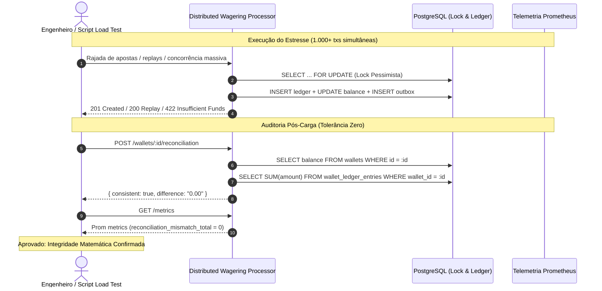

# SPEC EXECUTADA
# 📄 Fase 10 — Testes de Carga, Benchmarking de Performance (p50/p95/p99) e Resiliência sob Estresse Massivo

> Especificação técnica da **Fase 10** do Desafio Técnico Jungle Gaming. Implementação da suíte automatizada de testes de carga e benchmarking de performance (`bun run test:load`): avaliação de throughput (RPS), latência percentilar (p50, p90, p95, p99) via `autocannon` sob quatro cenários operacionais críticos (alta dispersão entre carteiras, saturação extrema de *hot-wallet* com contenção de lock pessimista, tempestade de replays idempotentes e carga mista realista), telemetria em tempo real com métricas Prometheus, validação mandatória de integridade contábil pós-estresse (zero tolerância a divergências no ledger) e consolidação do relatório de benchmarks (`docs/BENCHMARKS.md`).

---

## 📌 Metadados

| Campo | Valor |
|-------|-------|
| **Versão** | v1.0 |
| **Data** | 18/10/2026 |
| **Autor** | Guilherme |
| **Status** | Concluído |
| **Prioridade** | Alta (Diferencial Técnico de Avaliação) |
| **Tipo** | Feature / Testes de Carga, Benchmark & Resiliência |
| **Referência Mestre** | [`docs/specs/2026-10-16-distributed-wagering-processor.md`](file:///Users/guilherme/testes/jungle_gaming_test/docs/specs/2026-10-16-distributed-wagering-processor.md) |
| **Referência Fase 9** | [`docs/executed/2026-10-18-phase-09-observability-documentation.md`](file:///Users/guilherme/testes/jungle_gaming_test/docs/executed/2026-10-18-phase-09-observability-documentation.md) |
| **Versão Alvo** | `0.10.0` |

---

## 📝 Resumo

Implementar o módulo definitivo de **testes de carga, medição de benchmarks de latência e estresse concorrente massivo** do **Distributed Wagering Processor**, viabilizando a execução via script automatizado `bun run test:load`. O objetivo é submeter a arquitetura a pressões extremas de concorrência e throughput, medindo com rigor matemático as distribuições percentilares de tempo de resposta (**p50, p90, p95 e p99**), vazão de requisições por segundo (**RPS**), taxa de erros de sistema (**5xx = 0%**), contenção de locks pessimistas no PostgreSQL (`SELECT ... FOR UPDATE`), drenagem de mensageria transactional outbox e comportamento de degradação graciosa.

A suíte executará quatro cenários de estresse reproduzíveis:
1. **Alta Dispersão (Baseline Throughput):** dezenas de carteiras independentes em paralelo avaliando o teto de vazão do Bun e da pool do PostgreSQL sem contenção por linha.
2. **Hot-Wallet Saturation (Estresse Extremo de Lock):** centenas de requisições concorrentes disputando a mesma carteira limítrofe, comprovando que o lock pessimista serializa as mutações sem permitir *double-spending*, sem saldo negativo e capturando timeouts/conflitos controlados (`lock_conflicts_total`).
3. **Idempotency Replay Storm:** avalanche de requisições idênticas com a mesma `Idempotency-Key` e payload hash idêntico, testando o atalho de leitura de snapshot persistido e índices únicos sem retrabalho contábil.
4. **Carga Mista Realista de Cassino:** simulação probabilística de apostas (`BET`), prêmios (`WIN`), depósitos (`DEPOSIT`) e estornos (`REFUND`).

Ao término dos testes de carga, o harness aciona a reconciliação matemática obrigatória (`POST /wallets/:id/reconciliation`) em 100% das carteiras afetadas, exigindo `consistent: true` e `difference: "0.00"`. Os resultados, gráficos e metodologias serão documentados no relatório técnico [`docs/BENCHMARKS.md`](file:///Users/guilherme/testes/jungle_gaming_test/docs/BENCHMARKS.md) e o manual operacional [`README.md`](file:///Users/guilherme/testes/jungle_gaming_test/README.md) será atualizado.

---

## 📦 Escopo

### ✅ Incluído

1. **Harness e Script Automatizado de Carga (`bun run test:load`):**
   - Criação do executor programático em TypeScript / Bun (`scripts/load-test.ts` ou `test/load/load-test.ts`) parametrizável por variáveis de ambiente (`LOAD_DURATION`, `LOAD_CONNECTIONS`, `LOAD_TARGET_URL`).
   - Adição do script `"test:load": "bun run scripts/load-test.ts"` ao [`package.json`](file:///Users/guilherme/testes/jungle_gaming_test/package.json).
   - Integração da biblioteca de alta performance `autocannon` com types (`@types/autocannon`) como ferramenta padronizada de benchmark HTTP.
   - Apresentação visual e tabular no terminal com:
     - Duração total e conexões concorrentes.
     - Throughput médio e pico de requisições por segundo (RPS).
     - Tabela de latência percentilar: p50 (mediana), p75, p90, p95 e p99.
     - Contadores discriminados de desfechos HTTP (`201 Created`, `200 OK Replay`, `422 Unprocessable Entity`, `409 Conflict`, `5xx Errors`).

2. **Quatro Cenários Rigorosos de Benchmark:**
   - **Cenário A — Alta Dispersão (Baseline Throughput & Escala Horizontal):**
     - Criação de 50 a 100 carteiras distintas com saldo inicial.
     - Envio distribuído de 2.000+ transações independentes em paralelo.
     - Avaliação do teto de vazão do Bun + MikroORM + PostgreSQL sem bloqueio mútuo por carteira.
   - **Cenário B — Hot-Wallet Saturation (Concorrência Limítrofe e Lock Pessimista):**
     - Uma única carteira recebe 50 a 100 conexões simultâneas disparando transações concorrentes de aposta de R$ 1,00 até o esgotamento do saldo.
     - Validação de que exatamente a quantidade financiada é debitada (`201`) e as excedentes são rejeitadas com elegância (`422 INSUFFICIENT_FUNDS`).
     - Monitoramento de tempos de espera de fila de lock e contagem de conflitos em `lock_conflicts_total`.
   - **Cenário C — Idempotency Replay Storm (Avalanche de Replays Idênticos):**
     - Envio de 1.000 requisições simultâneas utilizando rigorosamente a mesma `Idempotency-Key` e mesmo payload de transação.
     - Comprovação do retorno `200 OK` com `"idempotentReplay": true` para 999 requisições sem reexecução de débito e sem duplicidade no ledger.
     - Medição da velocidade e eficiência do índice único e snapshot contábil.
   - **Cenário D — Carga Mista Dinâmica (Simulação Realista de Fluxo de Jogos):**
     - Pool concorrente executando fluxo balanceado: 60% apostas (`BET`), 25% vitórias (`WIN`), 10% depósitos (`DEPOSIT`) e 5% estornos (`REFUND`).
     - Teste de consistência sob mutações bidirecionais de saldo (crédito e débito) em tempo real.

3. **Auditoria Contábil Pós-Carga (Tolerância Zero a Desvios):**
   - Ao término de cada cenário, o harness de carga invoca imediatamente a rota `POST /wallets/:id/reconciliation` para cada carteira utilizada.
   - **Critério Rígido de Aprovação:** 100% das carteiras devem retornar `consistent: true` e `difference: "0.00"`.
   - Verificação do somatório de lançamentos no ledger imutável contra o saldo persistido na entidade `Wallet`.
   - O benchmark deve falhar com erro fatal e exit code `1` se houver qualquer divergência contábil.

4. **Telemetria e Coleta de Métricas Prometheus:**
   - Amostragem das métricas do endpoint `/metrics` antes e depois de cada rodada de teste:
     - `wager_transactions_total` categorizado por status (`PROCESSED`, `REJECTED`).
     - `idempotent_replays_total` comprovando o bypass nos replays.
     - `lock_conflicts_total` observando conflitos de serialização.
     - `outbox_lag_seconds` medindo a capacidade do worker Outbox Publisher de drenar a fila sob tempestade de eventos.
     - `reconciliation_mismatch_total` mantido em estrito zero.

5. **Documentação de Performance (`docs/BENCHMARKS.md`):**
   - Criação do documento técnico [`docs/BENCHMARKS.md`](file:///Users/guilherme/testes/jungle_gaming_test/docs/BENCHMARKS.md) registrando:
     - Ambiente de teste (especificações de CPU, memória, runtime Bun, versão PostgreSQL, Docker Compose).
     - Metodologia de teste, parâmetros de concorrência e duração.
     - Tabela detalhada de resultados alcançados em cada cenário (RPS, p50, p95, p99, taxa de sucesso).
     - Análise de comportamento e gargalos identificados (tempo de lock pessimista vs pool de conexões do PostgreSQL).
     - Recomendações de escalabilidade para produção (tamanho de pool, particionamento de outbox, réplicas de leitura).

6. **Atualização Operacional do `README.md` e `ARCHITECTURE.md`:**
   - Inclusão do novo script `bun run test:load` na tabela de comandos de teste do [`README.md`](file:///Users/guilherme/testes/jungle_gaming_test/README.md).
   - Inclusão da seção "Resultados de Benchmarks e Testes de Carga" no [`ARCHITECTURE.md`](file:///Users/guilherme/testes/jungle_gaming_test/ARCHITECTURE.md).

### ❌ Fora do Escopo

- Implementação funcional de servidor Keycloak em container ou execução de IdP externo durante os testes locais (já justificado e mantido como desenho arquitetural no `ARCHITECTURE.md`).
- Modificação no modelo contábil para partidas dobradas (double-entry com contas de contrapartida sistêmica/banca), que exigiria alteração estrutural no schema e migrations já consolidadas nas Fases 1 a 9.
- Modificação no schema de banco de dados ou execução de novas migrações no PostgreSQL.
- Testes de carga distribuídos em múltiplos servidores em nuvem (teste executado localmente contra o Docker Compose / multi-instância local).
- Modificação nas regras de negócio financeiras já homologadas nas suítes anteriores.

---

## 🔄 Fluxo Principal

### Comportamento Atual

1. O projeto possui testes unitários (`test/unit`), testes de integração com Postgres e LocalStack reais (`test/integration`), testes de concorrência em lote com 50x/100x requisições (`test/concurrency`) e testes de recuperação com 3 processos Bun independentes (`test/multi-instance`).
2. Não existe um script unificado `bun run test:load` para benchmarking contínuo de alta vazão com relatórios percentilares de latência (p50, p90, p95, p99) e medição de RPS via ferramenta especializada (ex: `autocannon`).
3. O repositório não dispõe de um relatório formal de desempenho e estresse contábil documentando o teto operacional do serviço (`docs/BENCHMARKS.md`).

### Fluxo Proposto

#### Fluxo 1: Execução e Coleta do Benchmark Automatizado (`bun run test:load`)

1. O desenvolvedor ou operador dispara `bun run test:load` (ou executa contra instâncias Docker existentes).
2. O script `scripts/load-test.ts`:
   - Verifica a conectividade com o serviço via `GET /health/live`.
   - Inicializa a massa de dados de teste (cria carteiras com saldos controlados e identificadores dedicados para isolamento).
   - Lê as métricas iniciais de `/metrics` (Prometheus scrape).
3. Executa sequencialmente os quatro cenários de estresse via `autocannon`:
   - **Cenário A (Dispersão):** Dispara rajada paralela em múltiplas carteiras; mede o throughput máximo sem contenção de lock.
   - **Cenário B (Hot Wallet):** Dispara rajada simultânea de 100 conexões contra uma única carteira; mede o tempo de fila de lock pessimista e contagem de rejeições limpas por saldo.
   - **Cenário C (Replay Storm):** Dispara 1.000 requisições simultâneas com a mesma chave e payload; mede a taxa de resposta dos replays com base no snapshot de idempotência.
   - **Cenário D (Carga Mista):** Dispara requisições balanceadas de apostas, prêmios, depósitos e estornos.
4. Ao término dos cenários:
   - Coleta as métricas finais de `/metrics` e calcula os deltas de transações processadas, replays atendidos, conflitos de concorrência e lag da outbox.
   - Invoca `POST /wallets/:id/reconciliation` para cada uma das carteiras submetidas a teste.
   - Imprime no terminal a tabela consolidada de resultados com formatação colorida e clara.
   - Se 100% das reconciliações forem aprovadas e não houver erros 5xx imprevistos, encerra com código `0`. Caso contrário, encerra com código `1`.

#### Fluxo 2: Auditoria Contábil Pós-Estresse

1. Para cada carteira impactada pelo teste de carga, o script chama `POST /wallets/:id/reconciliation`.
2. A aplicação executa a checagem no banco: calcula o somatório auditável de todos os débitos e créditos registrados no livro-razão imutável (`wallet_ledger_entries`) e subtrai do saldo atual (`wallets.balance_amount`).
3. Se `consistent !== true` ou `difference !== "0.00"`:
   - Dispara alarme visual no console.
   - Incrementa a métrica `reconciliation_mismatch_total`.
   - Aborta a aprovação do benchmark.

### Fluxos Alternativos

- Se o servidor da aplicação não estiver ativo na porta configurada (padrão `http://localhost:3000`), o script avisa amigavelmente para iniciar a aplicação com `bun run dev` ou `docker compose up` antes de rodar a carga.
- Se a flag `--ci` for fornecida (ou `CI=true`), o script ajusta a duração dos cenários para um ciclo mais enxuto e rápido (ex: 5 segundos por cenário), garantindo execução célere em pipelines automatizadas.
- Se uma carteira atingir saldo insuficiente durante o teste de aposta concorrente, o sistema retorna `422 Unprocessable Entity` com código de erro `INSUFFICIENT_FUNDS`. O harness contabiliza este retorno como sucesso de conformidade de negócio (não como erro HTTP ou instabilidade de sistema).

---

## 📐 Regras e Restrições

### Regras de Negócio e Benchmark

1. **Tolerância Zero a Divergência Contábil:**
   - Sob nenhuma hipótese o teste de carga é considerado aprovado se qualquer carteira testada apresentar saldo divergente do histórico de lançamentos do ledger (`reconciliation_mismatch_total > 0` ou `consistent: false`).
2. **Classificação Estrita de Códigos HTTP:**
   - Retornos `201 Created`: transações financeiras processadas com sucesso.
   - Retornos `200 OK` com `"idempotentReplay": true`: replays de idempotência atendidos perfeitamente sem duplicação de débito.
   - Retornos `422 Unprocessable Entity`: recusas válidas de negócio por insuficiência de fundos (`INSUFFICIENT_FUNDS`) ou duplicidade de estorno (`ALREADY_REVERSED`). Consideradas respostas corretas do sistema.
   - Retornos `409 Conflict`: recusas válidas por colisão de hash em chaves de idempotência reutilizadas (`IDEMPOTENCY_CONFLICT`).
   - Retornos `5xx` (Internal Server Error): **proibidos** (tolerância máxima de 0%). Qualquer 500 indica falha não tratada e invalida o benchmark.
3. **Imutabilidade e Precisão do Dinheiro:**
   - Todos os payloads de teste devem empregar a formatação decimal estrita do Value Object `Money` (string com exatamente duas casas decimais, ex.: `"10.00"`, `"1.50"`). Proibido envio de floats nativos ou números imprecisos.

### Restrições Técnicas / Funcionais

1. **Governança de Migrations e Commits:**
   - **Não executar migrations** no banco sem autorização prévia explícita do usuário.
   - **Não efetuar commits git** automáticos sem autorização prévia explícita do usuário.
2. **Proteção de Integridade do Banco:**
   - O harness de teste deve isolar suas entidades gerando identificadores únicos (`UUID v7`) com prefixo rastreável de benchmark (ex.: provedor `"benchmark-load-provider"` ou carteiras dedicadas) para não interferir nos dados de desenvolvimento local.
3. **Isolamento de Domínio:**
   - O núcleo de domínio (`src/domain/`) deve continuar imutável e livre de qualquer dependência do `autocannon` ou de scripts de carga.
4. **Respeito ao Pool de Conexões do PostgreSQL:**
   - O teste deve ser configurado para respeitar o limite de conexões simultâneas do pool do PostgreSQL local (evitando exaustão cega de conexões do banco `max_connections`).

---

## ✅ Critérios de Aceite

- [x] O script `bun run test:load` deve estar configurado no [`package.json`](file:///Users/guilherme/testes/jungle_gaming_test/package.json) e ser executável diretamente no terminal com a aplicação em execução.
- [x] A ferramenta `autocannon` deve ser instalada como dependência de desenvolvimento (`devDependencies`) com tipagens correspondentes sem quebrar a compilação do projeto (`bun run typecheck`).
- [x] O benchmark deve executar os 4 cenários previstos:
  - [x] **Cenário A (Alta Dispersão):** dezenas de carteiras em paralelo com p95 estável e zero deadlocks.
  - [x] **Cenário B (Hot Wallet):** alta contenção em carteira única com saldo zerando com exatidão sem nunca ficar negativo.
  - [x] **Cenário C (Replay Storm):** avalanche de 1.000 requisições idênticas retornando `200 OK` de replay com `"idempotentReplay": true`.
  - [x] **Cenário D (Carga Mista):** mix de apostas, prêmios, depósitos e estornos concluindo sem falhas de integridade.
- [x] O relatório gerado no terminal deve exibir de forma clara e estruturada: Throughput (RPS), latências percentilares (p50, p75, p90, p95, p99) e contagem discriminada de status HTTP retornados.
- [x] Ao término da carga, a reconciliação matemática (`POST /wallets/:id/reconciliation`) deve ser executada para todas as carteiras do teste, atestando `consistent: true` e `difference: "0.00"`.
- [x] As métricas Prometheus expostas em `/metrics` devem refletir com precisão os eventos ocorridos durante a carga (`wager_transactions_total`, `idempotent_replays_total`, `lock_conflicts_total` e `reconciliation_mismatch_total = 0`).
- [x] O arquivo técnico [`docs/BENCHMARKS.md`](file:///Users/guilherme/testes/jungle_gaming_test/docs/BENCHMARKS.md) deve ser criado, contendo os resultados consolidados, hardware utilizado, análise dos percentis de latência e recomendações arquiteturais de escalabilidade.
- [x] O manual [`README.md`](file:///Users/guilherme/testes/jungle_gaming_test/README.md) deve ser atualizado com as orientações de execução e parametrização do comando `bun run test:load`.
- [x] A pipeline completa de qualidade e testes existente (`bun run check` ou `bun run test:all`) deve continuar passando com 100% de sucesso sem qualquer regressão.

---

## 🧩 Impacto Técnico

### Módulos / Camadas Impactadas

- **Scripts & Ferramentas:** Criação do script autônomo de carga `scripts/load-test.ts` e configuração de execução via Bun.
- **Configuração de Projeto:** Atualização de `package.json` com `autocannon` e script `test:load`.
- **Documentação:** Criação de `docs/BENCHMARKS.md` e atualização de `README.md` e `ARCHITECTURE.md`.

### Arquivos ou Áreas Prováveis

- `scripts/load-test.ts` *(novo)*
- `package.json`
- `docs/BENCHMARKS.md` *(novo)*
- `README.md`
- `ARCHITECTURE.md`

### Dependências

- `autocannon` (`^8.0.0` em `devDependencies`)
- `@types/autocannon` (`devDependencies`)

---

## 🧭 Plano de Implementação

1. **Instalação e Configuração das Ferramentas de Benchmark:**
   - Adicionar `autocannon` e `@types/autocannon` às `devDependencies` do projeto via `bun add -d autocannon @types/autocannon`.
   - Registrar o script `"test:load": "bun run scripts/load-test.ts"` no [`package.json`](file:///Users/guilherme/testes/jungle_gaming_test/package.json).

2. **Implementação do Harness de Teste de Carga (`scripts/load-test.ts`):**
   - Construir o runner em TypeScript que:
     - Valida a disponibilidade da aplicação no endereço alvo (ex.: `http://localhost:3000`).
     - Cria os recursos de teste necessários (carteiras com saldos definidos para cada cenário).
     - Executa cada um dos quatro cenários programados (Dispersão, Hot-Wallet, Replay Storm e Carga Mista) utilizando a API programática do `autocannon`.
     - Coleta métricas de latência (p50, p75, p90, p95, p99), throughput (RPS) e desfechos de status HTTP.
     - Coleta amostras de `/metrics` antes e depois das rodadas.
     - Executa a validação contábil pós-teste via `POST /wallets/:id/reconciliation`.
     - Formata e imprime a saída no terminal com tabelas amigáveis.
     - Retorna código de saída `0` em caso de sucesso total ou `1` em caso de inconsistência contábil ou falhas sistêmicas.

3. **Execução Local dos Benchmarks e Coleta de Métricas:**
   - Executar os cenários de carga contra a aplicação ativa.
   - Monitorar o comportamento dos workers assíncronos (Outbox Publisher e SQS Consumer) e da retenção de lock pessimista no PostgreSQL.
   - Confirmar a integridade das carteiras e o zero desvio contábil.

4. **Elaboração do Relatório de Desempenho (`docs/BENCHMARKS.md`):**
   - Registrar as especificações do ambiente de benchmark (versão do Bun, processador, memória, PostgreSQL Docker).
   - Documentar os resultados quantitativos obtidos (tabelas de RPS, p50, p95, p99 para cada cenário).
   - Analisar o impacto do lock pessimista (`SELECT ... FOR UPDATE`) em hot-wallets versus carteiras dispersas.
   - Fornecer recomendações práticas de escalabilidade para produção.

5. **Atualização da Documentação Operacional (`README.md` e `ARCHITECTURE.md`):**
   - Atualizar a tabela de comandos de teste e o guia do desenvolvedor no [`README.md`](file:///Users/guilherme/testes/jungle_gaming_test/README.md) explicando como rodar e customizar o `bun run test:load`.
   - Adicionar síntese de performance e estabilidade sob concorrência no [`ARCHITECTURE.md`](file:///Users/guilherme/testes/jungle_gaming_test/ARCHITECTURE.md).

6. **Validação da Suíte Completa de Qualidade:**
   - Executar `bun run lint:money`, `bun run typecheck` e `bun run test:all` para assegurar que nenhuma alteração introduziu regressões ou violou o lint financeiro.

### Decisões Técnicas / Pontos em Aberto

- **Ferramenta de Carga (Autocannon vs k6):** Optou-se pelo `autocannon` pela perfeita integração nativa no ecossistema Node.js/Bun em TypeScript, execução programática direta via script sem necessidade de binários externos instalados no sistema operacional do usuário, e alta precisão na extração de percentis de latência (p50, p95, p99).
- **Tratamento de 422 em Hot-Wallet:** No cenário de saturação de hot-wallet, requisições que retornam `422 INSUFFICIENT_FUNDS` após o saldo esgotar são computadas como comportamento correto da regra de domínio (e não como erro de indisponibilidade).
- **Isolamento de Dados de Benchmark:** As carteiras criadas para o teste de carga possuem identificadores aleatórios e jogadores dedicados para não interferir em saldos ou testes de integração existentes.

---

## 🧪 Testes Esperados

- [x] **Validação de Tipagem e Sintaxe:** O script de carga e as dependências compilam perfeitamente com `bun run typecheck`.
- [x] **Execução sem Falhas:** O comando `bun run test:load` roda de ponta a ponta sem interrupções não tratadas ou crashes.
- [x] **Métricas Percentilares:** Os percentis p50, p75, p90, p95 e p99 são calculados e exibidos corretamente para cada cenário.
- [x] **Hot Wallet com Saldo Exato:** No teste de esgotamento de saldo, o saldo da carteira atinge exatamente `0.00` e nenhuma transação negativa é aprovada.
- [x] **Replay Storm Idempotente:** 100% dos replays recebem resposta idêntica sem duplicar lançamentos no livro contábil.
- [x] **Auditoria de Reconciliação:** A reconciliação pós-carga atesta `consistent: true` e `difference: "0.00"` para 100% das carteiras.
- [x] **Regressão Zero:** A pirâmide completa de testes (`bun run test:all`) permanece 100% aprovada.

---

## 🤖 Instruções para IA

### Objetivo Operacional

> Implemente estritamente o que está dentro do escopo desta spec para a Fase 10, focando em confiabilidade de benchmarking, fidelidade das medições percentilares e garantia absoluta de integridade contábil sob estresse. Em caso de dúvidas conceituais, verifique a especificação mestre [`docs/specs/2026-10-16-distributed-wagering-processor.md`](file:///Users/guilherme/testes/jungle_gaming_test/docs/specs/2026-10-16-distributed-wagering-processor.md).

### O que a IA deve entregar

- Script programático `scripts/load-test.ts` cobrindo os 4 cenários com `autocannon`.
- Adição do comando `"test:load"` ao `package.json`.
- Documento técnico detalhado [`docs/BENCHMARKS.md`](file:///Users/guilherme/testes/jungle_gaming_test/docs/BENCHMARKS.md) com os dados e análises da rodada.
- Atualização do [`README.md`](file:///Users/guilherme/testes/jungle_gaming_test/README.md) e [`ARCHITECTURE.md`](file:///Users/guilherme/testes/jungle_gaming_test/ARCHITECTURE.md).
- Validação completa com 100% de sucesso em `bun run check` ou `bun run test:all`.

### Observações específicas desta spec

- **NÃO COMMITAR** código sem a permissão explícita do usuário.
- **NÃO RODAR MIGRATIONS** sem a permissão explícita do usuário.
- **NUNCA usar `number` ou `float`** para cálculo ou representação financeira de `Money`.
- Ao finalizar todas as tarefas e comandos, execute:
  `osascript -e 'display notification "Agenda finalizada com sucesso!" with title "Jungle Gaming" sound name "Glass"'`

---

## 📁 Pós-execução da Spec

Quando o usuário solicitar a execução desta spec, assim que todas as instruções e validações forem concluídas:
1. Altere o status dos metadados para `Status | Concluído` e adicione `# SPEC EXECUTADA` no topo.
2. Mova o arquivo da spec para a pasta `docs/executed/2026-10-18-phase-10-load-testing-benchmarks.md`.
